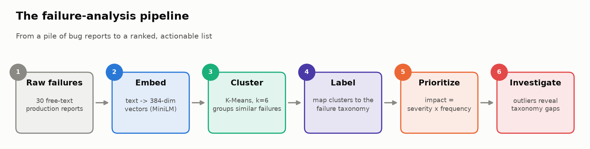
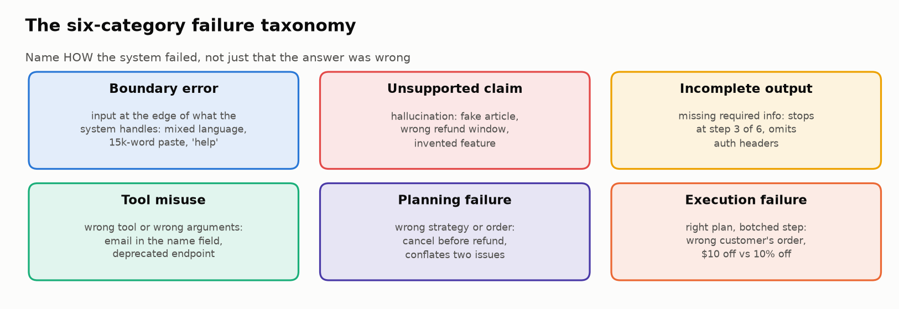
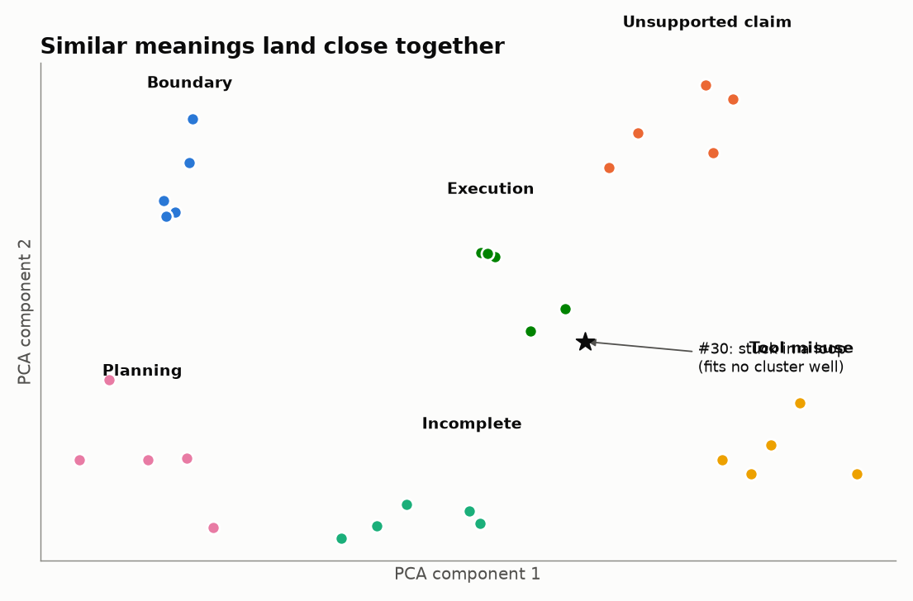
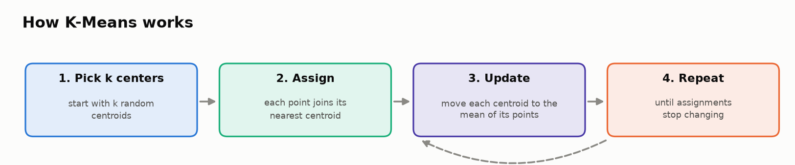
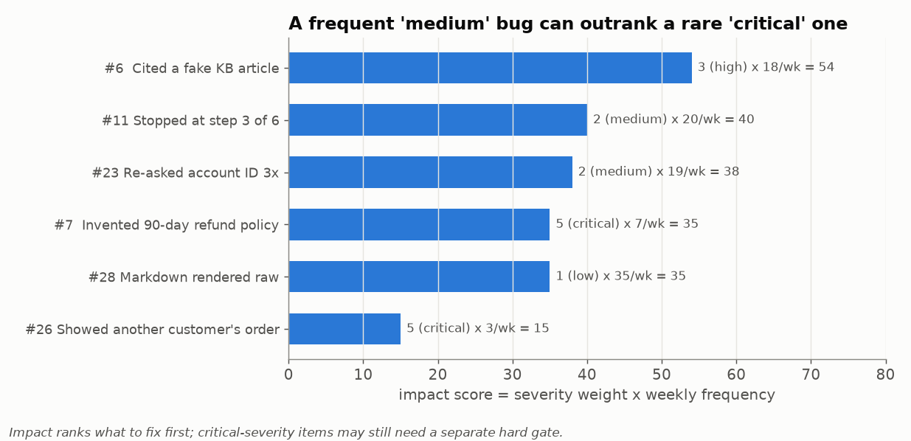

# 🔍 Module 02: Failure Mode Analysis

> **Lab:** [`labs/02-failure-analysis-lab.ipynb`](../../labs/02-failure-analysis-lab.ipynb) · **Time:** 20–25 min · **Tools:** `sentence-transformers`, `scikit-learn`, `pandas` · **Keys needed:** none



---

## 🧭 Overview

Module 01 gave you a way to *see* what an AI system did. This module answers the next question: **when it goes wrong, what kinds of wrong are there, and which kind matters most?**

You'll take 30 messy, free-text failure reports from a customer-support assistant and turn them into a structured, prioritized picture:

1. 📂 **Load** the raw reports (description + severity + frequency + user-facing flag).
2. 🤔 **Predict** the categories yourself, before any algorithm runs.
3. 🧮 **Embed** each description as a 384-number vector that captures its meaning.
4. 🔬 **Cluster** similar failures with K-Means.
5. 🏷️ **Label** clusters using a six-category failure taxonomy.
6. 📊 **Prioritize** clusters by **impact = severity × frequency**.
7. 🧩 **Investigate** the outlier that doesn't fit, and ask whether the taxonomy is missing something.

---

## 💡 Why This Matters

Production failures don't arrive labelled. They arrive as support tickets, QA notes, angry tweets and trace annotations: hundreds of slightly different sentences describing overlapping problems. Teams that read them one by one tend to fix **whichever bug was reported last, or sounds scariest**.

Failure-mode analysis replaces that with evidence:

- 🗂️ **Structure:** "We have 6 kinds of failure, not 30 bugs."
- 🎯 **Prioritization:** "This *kind* costs the most, so we fix it first."
- 🔭 **Early warning:** "These outliers don't fit our categories, so something new is happening."
- 🔁 **Better evaluation:** every category you name becomes something you can write a check for. *If you can't name a failure mode, you won't build an evaluator that detects it.*

> 🧠 **Insight:** the taxonomy you build here reappears in Module 06 (agent root causes) and Lab 06b (naming failure modes from transcripts). It's the bridge between "something went wrong" and "here's the test that catches it".

---

## 🎯 Learning Objectives

After this module you will be able to:

1. **Apply** a failure taxonomy (boundary, unsupported claim, incomplete output, tool misuse, planning, execution) to real failure descriptions.
2. **Explain** what text embeddings are and why they make large-scale failure grouping possible.
3. **Cluster** failures with K-Means and **visualize** them with PCA, knowing what the 2-D picture can and can't tell you.
4. **Validate** algorithmic clusters against your own hypotheses instead of trusting them blindly.
5. **Prioritize** failure categories with an impact score, and recognize when severity needs a separate hard rule.
6. **Identify** long-tail and outlier failures that signal gaps in your taxonomy.

---

## 📋 Prerequisites

- ✅ Module 01 (what traces and scores are).
- 🐼 Basic `pandas`: DataFrames, `groupby`, filtering.
- 📐 A rough idea of vectors and "distance between points". (No linear algebra needed beyond that.)

---

## 🧩 Key Concepts

### 1. 🏷️ A failure taxonomy

A **taxonomy** is a fixed set of named categories that describe *how* something failed. Good categories describe **mechanisms**, not outcomes ("wrong answer" is an outcome; "cited a non-existent source" is a mechanism).



| Category | Mechanism | Example from the lab dataset | Typical evaluator |
|---|---|---|---|
| 🌐 **Boundary error** | Input outside what the system handles well | Mixed French/English question answered only in English (#1) | Robustness / perturbation tests (Module 07) |
| 🤥 **Unsupported claim** | Hallucination or fabrication | "90-day money-back guarantee"; actual policy is 30 days (#7) | Factuality / faithfulness checks (Modules 04, 05) |
| ✂️ **Incomplete output** | Required information missing | Password reset that omits email verification (#12) | Completeness checks, required-field rules |
| 🔧 **Tool misuse** | Wrong tool, or right tool with wrong arguments | Email address passed in the *name* field (#17) | Tool selection & input validation (Module 06) |
| 📋 **Planning failure** | Wrong strategy or order of steps | Cancelled the subscription *before* processing the refund that needed it (#21) | Process constraints, trajectory checks |
| ⚡ **Execution failure** | Right plan, botched step | Entered "10" as $10 off instead of 10% off (#27) | End-state / value checks |

> ⚠️ Categories overlap at the edges. A failure can be *both* a planning and a tool problem. Pick the **primary** mechanism (the one whose fix would prevent it) and note the rest.

### 2. 🧮 Embeddings: turning sentences into geometry

An **embedding model** maps text to a vector (a list of numbers) such that **similar meanings land close together**. The lab uses `all-MiniLM-L6-v2`, a small, fast model that outputs **384** numbers per sentence.

```
"Assistant fabricated a phone number"     → [0.12, -0.34, 0.87, …]  ┐  close together:
"Assistant cited a non-existent article"  → [0.11, -0.31, 0.85, …]  ┘  both are fabrications
"Response formatting broke in chat"       → [-0.40, 0.22, 0.05, …]     far away
```

Two vectors' **cosine similarity** (1.0 = same direction, 0 = unrelated) measures how alike their meanings are. This beats keyword matching: the two fabrication examples share almost no words.



You never need to interpret an individual dimension. What matters is **relative distance**.

### 3. 🔬 Clustering with K-Means



K-Means splits points into **k** groups so that each point is close to its group's **centroid** (the group's average vector). In the lab: `KMeans(n_clusters=6, random_state=42, n_init=10)`.

- **k is your choice.** The lab uses 6 because the taxonomy has 6 categories. In real work you'd try several values (and look at silhouette scores or simply read the clusters).
- **`random_state` makes runs reproducible**; `n_init=10` runs 10 different starts and keeps the best.
- **Clusters are not labels.** The algorithm groups things that *sound alike*. Deciding what each group *means* is your job (Task 6).
- **Imbalance is normal.** In the verified lab run, cluster sizes are 11, 7, 6, 2, 2, 2. Real failure data is lumpy.

**PCA for plotting:** you can't draw 384 dimensions, so the lab projects them to 2 with **PCA** (principal component analysis). Use the plot to *eyeball* structure, but trust the clusters, which were computed in the full 384-D space. Two dots that look close in 2-D can be far apart in reality.

### 4. 🤔 Hypothesize before you cluster

Task 3 asks you to predict the categories **before** you see any clusters. That's not busywork:

- Without a hypothesis you have no way to judge whether the algorithm's groups are meaningful or garbage.
- Disagreements are valuable: either the algorithm found a pattern you missed, or it grouped things by surface wording rather than mechanism.

> 🧪 In the verified run, one cluster mixes a hallucinated policy (#7), a tool call to the wrong API (#16), and a plan to upgrade for a bug that exists in every tier (#25). The embedding grouped them by **topic** (billing, plans, pricing), not by **mechanism**. Only a human reading the cluster notices.

### 5. 📊 Impact scoring: what to fix first



The lab's impact score is:

```
impact = severity_weight × weekly_frequency      weights: low 1 · medium 2 · high 3 · critical 5
```

Then sum per cluster to rank **categories**. Two lessons:

1. **Frequency can beat severity.** A medium bug hitting 20 users a week (impact 40) outranks a critical one hitting 3 (impact 15).
2. **…but some failures need a hard rule anyway.** Showing one customer another customer's order (#26) is a privacy incident no matter how rare. Impact ranks the **backlog**; critical safety/privacy failures may deserve a **gate** regardless of rank. (You'll formalize "hard gates vs. averages" in Module 06.)

> ✍️ Severity weights are a **judgment call**. Write them down, agree on them as a team, and revisit them. Changing `critical` from 5 to 10 can reorder your whole roadmap.

### 6. 🧩 Outliers and the long tail

Failure #30 is an assistant **stuck in a loop**, repeatedly asking "Is there anything else I can help you with?" It doesn't fit any category well. In the verified run, its cosine similarity to its own cluster's centroid is about **0.66**, while its similarity to individual members of that cluster is only **0.26–0.47**: a weak fit.

What outliers tell you:

- 🆕 A **new failure mode** may be emerging (here: *looping / no progress*, which becomes a first-class check in Module 06).
- 🧱 Your taxonomy may need a new category, or a "system-level behavior" bucket.
- 📈 The **long tail** (many rare, unique failures) is where surface metrics are blindest.

> 💡 **Taxonomies are living documents.** Review them as you see new failures; a taxonomy that never changes is falling behind your system.

---

## 🧪 Example Walkthrough

The full pipeline is only a few lines of code:

```python
from sentence_transformers import SentenceTransformer
from sklearn.cluster import KMeans

model = SentenceTransformer("all-MiniLM-L6-v2")
embeddings = model.encode(df["description"].tolist())        # shape (30, 384)

df["cluster"] = KMeans(n_clusters=6, random_state=42, n_init=10).fit_predict(embeddings)

severity_weights = {"low": 1, "medium": 2, "high": 3, "critical": 5}
df["impact_score"] = df["severity"].map(severity_weights) * df["frequency"]

ranking = (df.groupby("cluster")
             .agg(total_impact=("impact_score", "sum"), n=("id", "count"),
                  critical=("severity", lambda s: (s == "critical").sum()))
             .sort_values("total_impact", ascending=False))
```

What the numbers look like in the verified run:

| Cluster (size) | Total impact | Critical failures | Your label? |
|---|---|---|---|
| 1 (11) | **275** | 0 | *you decide in Task 6* |
| 0 (7) | 184 | 3 | |
| 4 (6) | 137 | 2 | |
| 3 (2) | 69 | 1 | |
| 5 (2) | 63 | 0 | |
| 2 (2) | 51 | 0 | |

Notice the top cluster by total impact has **zero** critical failures, while cluster 0 holds three. Is "most total impact" the right thing to fix first? That's the kind of judgment the lab asks you to make and defend.

---

## ⚠️ Common Mistakes or Misunderstandings

| ❌ Mistake | ✅ Instead |
|---|---|
| Running the algorithm before reading the data | Read the 30 descriptions and write predictions first (Task 3). |
| Treating cluster IDs as meaningful labels | Clusters are groupings; meaning comes from your labeling. |
| Trusting the PCA plot over the cluster assignments | PCA compresses 384 → 2 dimensions; distances distort. |
| Forcing every failure into a category | Outliers are a signal. Record them, don't hide them. |
| Ranking only by severity, or only by count | Use impact (severity × frequency), *plus* hard rules for critical failures. |
| Assuming k=6 is "correct" | k is a modelling choice; try others (Stretch goal) and compare. |
| Labeling a cluster by its most dramatic member | Label by the **majority mechanism**; note exceptions explicitly. |

---

## 🚀 Before You Start the Lab

- ⏬ The first run downloads `all-MiniLM-L6-v2` (~90 MB). That's normal and takes under a minute on Colab.
- 🗒️ Open a scratch note for Task 3 and commit to your predictions *before* clustering.
- 🧭 While labeling, ask of each cluster: "What **single fix** would prevent most of these?" That's usually its true category.
- 🎯 Be ready to defend your top-priority cluster in one sentence to a manager who doesn't want a list of 30 bugs.

---

## 🔑 Key Takeaways

1. 🏷️ **Name mechanisms, not outcomes.** A taxonomy turns "wrong answers" into fixable categories, and each category into a future evaluator.
2. 🧮 **Embeddings + clustering create structure from free text** at a scale humans can't read.
3. 🤔 **Hypothesize first.** Your predictions are the yardstick for judging the algorithm.
4. 📊 **Impact = severity × frequency** ranks the backlog. Keep separate hard rules for privacy and safety failures.
5. 🧩 **Outliers reveal taxonomy gaps.** Looping didn't fit; it becomes a first-class check in Module 06.
6. 🔁 **Taxonomies evolve.** Revisit them whenever new failure patterns appear.

---

## 🧠 Self-Check

<details>
<summary>1. Two failure descriptions share almost no words but end up in the same cluster. Is that a bug?</summary>

Usually not: that's what embeddings are for. They capture meaning ("fabricated a phone number" ≈ "cited a non-existent article"). Do check that the shared meaning is the *mechanism* and not just the *topic*.
</details>

<details>
<summary>2. A failure is critical but happens twice a week. Another is low severity and happens 35 times a week. Which has more impact, and is impact the whole story?</summary>

Critical × 2 = 10; low × 35 = 35, so the low-severity one has more impact. But a critical privacy or financial failure may warrant an immediate fix or a release gate regardless of its impact rank.
</details>

<details>
<summary>3. Why does the lab compare failure #30 to the cluster <em>centroid</em> and to individual cluster members?</summary>

The centroid similarity says how well it fits the group's average meaning; similarities to individual members show whether it actually resembles any of them. High-ish centroid similarity with low member similarities suggests it was assigned by elimination, which is a sign of an outlier.
</details>

<details>
<summary>4. What would you expect to happen with k = 4? With k = 10?</summary>

With k = 4, distinct mechanisms get merged (e.g. tool misuse with execution failures). With k = 10, real categories split into topic-level sub-clusters and singletons. Neither is "wrong": choose k by whether the resulting groups are *actionable*.
</details>

---

## 📖 Glossary

**Taxonomy** · a fixed set of named failure categories. **Embedding** · a vector representation of text where similar meanings are close. **Cosine similarity** · similarity of two vectors' directions, from −1 to 1. **K-Means** · clustering into k groups around centroids. **Centroid** · the mean vector of a cluster. **PCA** · projection to fewer dimensions for visualization. **Impact score** · severity weight × frequency. **Long tail** · the many rare, unique failures. **Outlier** · a failure that fits no cluster well.
