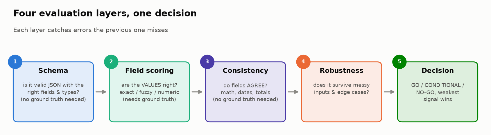
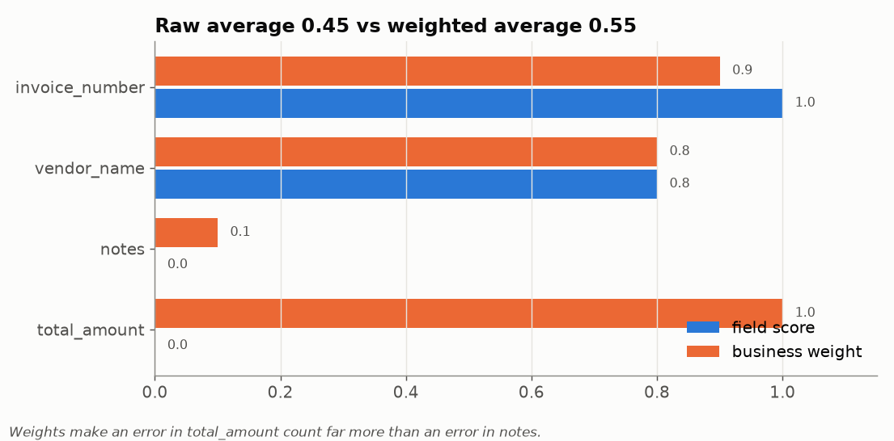
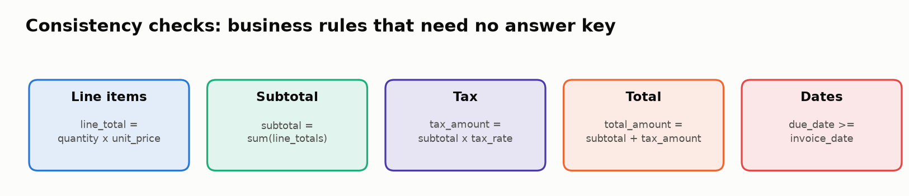
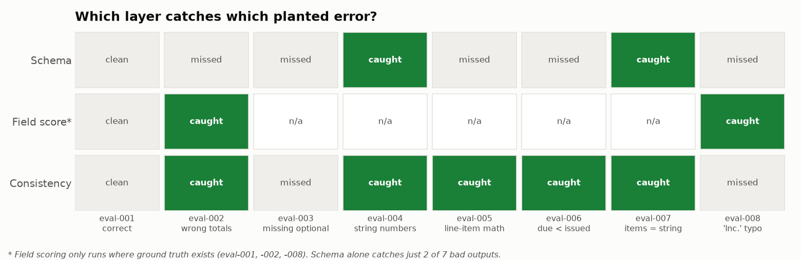

# 📋 Module 03: Evaluating Structured Outputs

> **Lab:** [`labs/03-structured-outputs-lab.ipynb`](../../labs/03-structured-outputs-lab.ipynb) · **Time:** 25–30 min · **Tools:** `jsonschema`, Python · **Keys needed:** none



---

## 🧭 Overview

Many production LLM features don't produce prose. They produce **data**: JSON for an invoice, a form, a classification, an API call. That output feeds databases, payments and downstream code, so a mistake doesn't just read badly; it **does** something wrong.

In this module you'll evaluate an LLM that extracts invoices into JSON, by building a four-layer evaluation suite:

| Layer | Question | Needs ground truth? |
|---|---|---|
| 📐 **Schema validation** | Is it well-formed: right fields, right types, right formats? | ❌ No |
| 🎯 **Field-level scoring** | Are the *values* right, weighted by business impact? | ✅ Yes |
| 🔗 **Cross-field consistency** | Do the fields agree with each other (math, dates)? | ❌ No |
| 🛡️ **Robustness testing** | Does evaluation still behave sensibly on messy variations? | ❌ No |

…and then combining them into a **GO / CONDITIONAL / NO-GO** deployment recommendation.

---

## 💡 Why This Matters

> 🧾 *"Valid JSON"* is the most dangerous phrase in structured-output evaluation.

A response like `{"total_amount": 2290.00}` passes every type check and still charges a customer **$27.57 too much**. In the lab's dataset, schema validation catches only **2 of the 7** broken outputs. The rest are structurally perfect and semantically wrong.

Structured outputs are also where evaluation is **most automatable**: fields can be compared exactly, rules can be encoded, and the checks are cheap enough to run on every single output in production, including the ones you have no labels for. Getting this layer right gives you a safety net that works 24/7 without an LLM judge.

---

## 🎯 Learning Objectives

After this module you will be able to:

1. **Write** a JSON Schema for an LLM extraction task and validate outputs against it, collecting *all* errors.
2. **Explain** why schema validity is necessary but insufficient.
3. **Score** individual fields with the right comparison for each type (exact, fuzzy, numeric tolerance) and **weight** them by business impact.
4. **Encode** business rules as cross-field consistency checks that need no ground truth.
5. **Design** robustness perturbations and interpret what they reveal.
6. **Combine** layers into a deployment decision with explicit thresholds, where the weakest signal wins.

---

## 📋 Prerequisites

- ✅ Modules 01–02.
- 🧾 Reading JSON: objects, arrays, strings vs. numbers.
- 🐍 Python dicts, loops, `datetime.strptime`, `try/except`.

---

## 🧩 Key Concepts

### 1. 📐 JSON Schema: the contract

A **JSON Schema** is a machine-readable description of what a valid document looks like. In the lab:

```python
invoice_schema = {
  "type": "object",
  "required": ["invoice_number", "vendor_name", "invoice_date", "line_items",
               "subtotal", "tax_rate", "tax_amount", "total_amount", "currency"],
  "properties": {
    "invoice_number": {"type": "string", "pattern": "^INV-\\d{4}-\\d{3}$"},
    "line_items": {"type": "array", "minItems": 1,
                   "items": {"type": "object",
                             "required": ["description", "quantity", "unit_price", "line_total"],
                             "properties": {"quantity": {"type": "number", "minimum": 0}, ...}}},
    "tax_rate": {"type": "number", "minimum": 0, "maximum": 1},
    "currency": {"type": "string", "enum": ["USD", "EUR", "GBP", "CAD"]},
    ...
  }
}
```

| Keyword | What it enforces | Lab example it catches |
|---|---|---|
| `required` | Field must be present | — |
| `type` | string / number / array / object | eval-004 (`"10"` instead of `10`), eval-007 (`line_items` is a sentence) |
| `pattern` | Regex on strings | malformed invoice numbers |
| `enum` | Allowed values only | `"Dollars"` as a currency |
| `minimum` / `maximum` | Numeric bounds | negative quantities, `tax_rate: 8` |
| `minItems` | Non-empty arrays | an invoice with no line items |

> 💡 **Collect all errors, not just the first.** `jsonschema.validate()` raises on the first problem. `Draft7Validator(schema).iter_errors(doc)` lists them all, which is what you want in an evaluation report.

> ⚠️ **Gotcha:** `"format": "date"` is only **annotated** by default; it isn't enforced unless you pass a `FormatChecker`. That's why the MM/DD/YYYY perturbation still validates in Task 8 (and why Exercise 3 exists).

### 2. 🎯 Field-level scoring: right comparison for each field

Different fields need different notions of "equal":

| Comparison | Fields | Why |
|---|---|---|
| **Exact** | `invoice_number`, `currency`, dates, `payment_terms` | One wrong character is a different invoice |
| **Fuzzy string** | `vendor_name`, `vendor_address`, `notes` | Capitalization, whitespace and OCR noise are tolerable… up to a point |
| **Numeric tolerance** | `subtotal`, `tax_amount`, `total_amount`, `tax_rate` | Floating-point rounding (172.425 vs 172.43) shouldn't fail a field |
| **Nested / per-item** | `line_items` | Compare each item's fields, then average |

The lab's fuzzy matcher uses **Jaccard similarity of character sets**, which is why `"TechParts lnc."` (lowercase **L**) vs `"TechParts Inc."` still scores very high. It's a deliberately simple matcher, and a great example of a scorer that's *too lenient* (Stretch goal 1 swaps in `difflib.SequenceMatcher`).

### 3. ⚖️ Impact weighting



Not all fields matter equally. A wrong `notes` field is a nuisance; a wrong `total_amount` is a wrong payment. Weighted accuracy:

```
weighted_score = Σ (field_score × weight) / Σ weight
```

In the example above, the raw average (0.45) makes the invoice look "almost half right". The weighted average (0.55) still looks mediocre, but the real story is that the single most important field, `total_amount`, scored **0**. That's why the lab's decision table also has a **critical-field accuracy** threshold of 100%: some fields need their own gate, not just a heavier weight.

> 🧭 **Weights are domain decisions.** For medical records, a medication dose would be weighted like `total_amount` here. Write down *why* each weight is what it is (Task 5 asks you to).

### 4. 🔗 Cross-field consistency: business rules without an answer key



Consistency checks verify **relationships** that hold for *every* valid invoice, whatever its values:

| Rule | Catches in the lab |
|---|---|
| `line_total == quantity × unit_price` | eval-005: 50 × 22.00 = 1,100, not 1,200 |
| `subtotal == Σ line_total` | eval-005 again (its subtotal includes the bad line) |
| `tax_amount == subtotal × tax_rate` | eval-002: 2,090 × 0.0825 = 172.43, not 200.00 |
| `total_amount == subtotal + tax_amount` | — see the insight below |
| `due_date ≥ invoice_date` | eval-006: due March 15 for an invoice issued April 1 |

> 🔎 **Insight from the retest:** for eval-002 only the **tax** rule fires. Its total (2,290) *equals* subtotal + the wrong tax (2,090 + 200), so the total rule passes. One upstream error can make downstream fields look internally consistent. This is why you check **every** relationship, not just the final one.

Because they need no labels, consistency checks are your **primary defense on unlabeled production traffic**. Two implementation habits matter:

- Use a **tolerance** (the lab uses $0.02) for money math.
- **Never crash on bad types.** eval-004 has string quantities; report "non-numeric quantity" as an issue rather than raising a `TypeError` that stops the whole evaluation run.

### 5. 🛡️ Robustness testing

A clean test set shows your system's *ceiling*. Robustness tests probe the *floor*: what happens with real-world mess?

| Perturbation family | Examples to try in Task 8 |
|---|---|
| **Format variation** | `03/15/2024` dates, `"$486.00"` as a string, `1,000.00` with a comma |
| **Edge cases** | empty `line_items`, one huge line, very long vendor names |
| **Noise** | uppercase + extra whitespace in names, typos, Unicode |
| **Boundary values** | zero amounts, negative quantities, `tax_rate: 8` (percent, not fraction) |

Each perturbation tells you something about **both** the model (would it produce this?) and **your evaluator** (does it catch it, crash on it, or wave it through?). In the verified solution run, 4 of 6 perturbations fail schema validation, and the MM/DD/YYYY date passes schema (format unchecked) but trips the date-ordering consistency check.

### 6. 🚦 From metrics to a decision



The lab's decision framework:

| Metric | 🟢 GO | 🟡 CONDITIONAL | 🔴 NO-GO |
|---|---|---|---|
| Schema pass rate | ≥ 95% | 85–94% | < 85% |
| Weighted field accuracy | ≥ 0.90 | 0.75–0.89 | < 0.75 |
| Consistency pass rate | ≥ 90% | 75–89% | < 75% |
| Critical-field accuracy | 100% | ≥ 95% | < 95% |

**The most conservative signal wins.** With reference solutions, the lab produces schema 75%, weighted accuracy 0.925, consistency 38% → **🔴 NO-GO**, even though field accuracy alone would say GO. Notice that the decision is driven by the two layers that *don't* need ground truth.

---

## 🧪 Example Walkthrough

One invoice, all four layers:

```python
inv = {k: v for k, v in model_outputs[4].items() if k != "id"}      # eval-005

# 1. Schema: structurally fine
errors = list(jsonschema.Draft7Validator(invoice_schema).iter_errors(inv))   # → []

# 2. Field scoring: no ground truth for eval-005 → skipped (realistic!)

# 3. Consistency
for i, it in enumerate(inv["line_items"], 1):
    if abs(it["quantity"] * it["unit_price"] - it["line_total"]) > 0.02:
        print(f"item {i}: {it['quantity']} x {it['unit_price']} != {it['line_total']}")
# → item 2: 50 x 22.0 != 1200.0

# 4. Robustness: does the evaluator survive a perturbation of this invoice?
bad = deepcopy(inv); bad["tax_rate"] = 6        # percent instead of fraction
list(jsonschema.Draft7Validator(invoice_schema).iter_errors(bad))   # → ['6 is greater than the maximum of 1']
```

A structurally valid invoice, no ground truth available, and the consistency layer still finds a $100 overcharge.

---

## ⚠️ Common Mistakes or Misunderstandings

| ❌ Mistake | ✅ Instead |
|---|---|
| "It parsed, so it's correct." | Schema checks structure; values and relationships need their own layers. |
| Weighting every field equally | Weight by business impact, and gate critical fields separately. |
| Exact-matching names and addresses | Use fuzzy matching with a deliberate threshold, and test the matcher on known near-misses. |
| Comparing money with `==` | Use a tolerance (e.g. $0.02). |
| Consistency checks that crash on bad types | Treat type problems as reported issues, not exceptions. |
| Only evaluating outputs you have labels for | Schema + consistency run on 100% of traffic. |
| Averaging the layers into one score | The weakest layer decides; report each layer. |
| Assuming `"format": "date"` is enforced | Pass a `FormatChecker` if you need format validation. |

---

## 🚀 Before You Start the Lab

- ✍️ Task 5 has **no defaults**: the notebook stops with an `AssertionError` until you assign weights. That's intentional.
- 🧮 Keep a calculator handy (or Python) to sanity-check invoice math by hand.
- 🔁 In Task 7, implement **at least three** checks. After running them, compare your results against the checkpoint table; a check that never fires is suspicious.
- 💭 For Task 8, think like a **messy real-world invoice**, not like a test-writer.

---

## 🔑 Key Takeaways

1. 📐 **Schema validation is necessary but insufficient**: it caught 2 of 7 broken outputs.
2. 🎯 **Match the comparison to the field**: exact, fuzzy, or numeric tolerance.
3. ⚖️ **Weight by impact and gate critical fields**: a perfect `notes` field can't offset a wrong total.
4. 🔗 **Consistency checks need no labels**, so they're your 24/7 production safety net, and errors can propagate so check every relationship.
5. 🛡️ **Robustness tests reveal the floor**, and they test your evaluator as much as your model.
6. 🚦 **Decisions use the weakest signal.** Metrics exist to drive GO / NO-GO calls.

---

## 🧠 Self-Check

<details>
<summary>1. eval-008 has vendor "TechParts lnc." (lowercase L). Which layer catches it, and why might it slip through?</summary>

Only field-level scoring (it has ground truth). It may slip through because the character-set Jaccard matcher scores it very close to 1.0. A stricter matcher (edit distance) or a threshold close to 1 for vendor names would flag it.
</details>

<details>
<summary>2. Why are consistency checks described as the primary production defense?</summary>

They don't need ground truth, so they can run on every output, including the ~100% of production traffic that will never be labelled.
</details>

<details>
<summary>3. eval-002's total check passes. Explain why, and what that teaches you.</summary>

The total equals subtotal + the (wrong) tax, so it's internally consistent with an upstream error. Errors propagate; check each relationship separately and look at the earliest broken one.
</details>

<details>
<summary>4. Your weighted field accuracy is 0.93 (GO) but consistency pass rate is 38% (NO-GO). What do you recommend?</summary>

NO-GO. The most conservative signal wins; also note that field accuracy was measured on only 3 labelled outputs, while consistency ran on all 8.
</details>

---

## 📖 Glossary

**JSON Schema** · a declarative description of valid JSON. **Required field** · must be present. **Field-level scoring** · per-field comparison to ground truth. **Fuzzy matching** · similarity-based string comparison. **Impact weighting** · weighting fields by business consequence. **Consistency check** · a rule relating fields that holds for every valid record. **Perturbation** · a controlled change to an input to test robustness. **Go/No-Go** · a deployment decision derived from thresholds.
