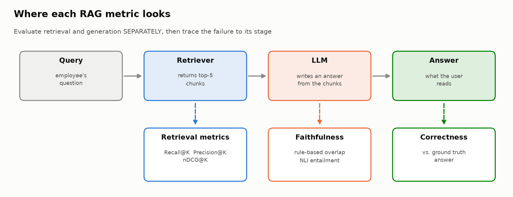
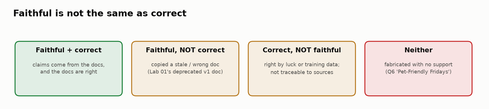
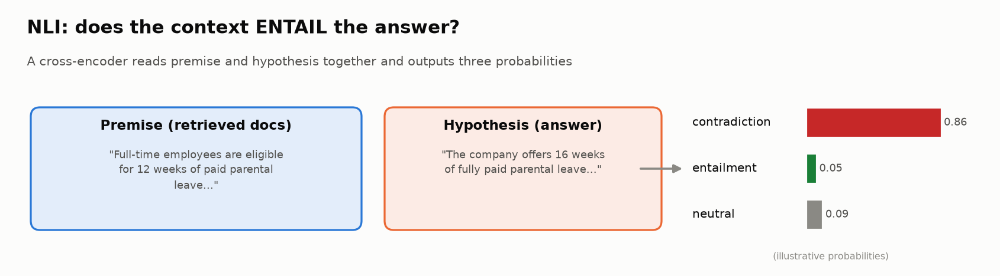
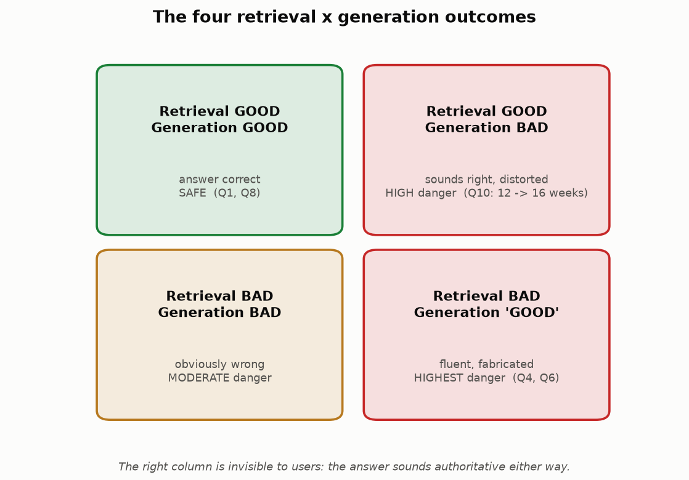

# 🔎📚 Module 04: Evaluating Retrieval-Augmented Systems (RAG)

> **Lab:** [`labs/04-rag-evaluation-lab.ipynb`](../../labs/04-rag-evaluation-lab.ipynb) · **Time:** 25–30 min · **Tools:** `sentence-transformers` (NLI cross-encoder), `pandas` · **Keys needed:** none
>
> **Supplemental lab:** [`labs/04b-production-rag-lab.ipynb`](../../labs/04b-production-rag-lab.ipynb) builds a real RAG pipeline on a vector database. See the [Module 04b handout](../module-04b/student-handout.md).



---

## 🧭 Overview

**Retrieval-Augmented Generation (RAG)** answers questions by first **retrieving** relevant documents and then asking an LLM to **generate** an answer from them. It's the most common architecture for "chat with your documents" products, and it has two places to fail instead of one.

In this module you'll evaluate a company-policy Q&A system across 12 queries:

1. 📏 Measure **retrieval** quality with Recall@K, Precision@K and nDCG.
2. 📝 Design **grounding** criteria: when is an answer supported by its sources?
3. 🧪 Score **faithfulness** two ways: word overlap and an **NLI** entailment model, and find where each fails.
4. 💥 Design **stress tests** (ambiguous, adversarial, out-of-scope, contradictory queries).
5. 🔬 Combine everything into a per-query **trace analysis** that names the root cause: retrieval, generation, or both.
6. ⚖️ Analyze the most dangerous cases: where retrieval and generation quality **diverge**.

---

## 💡 Why This Matters

Management's complaint in the lab scenario is the classic RAG complaint: *answers that "sound right but aren't."* Two of the 12 queries retrieved **zero** relevant documents, and the system still produced confident, detailed answers. One query retrieved excellent documents and the answer quietly changed **12 weeks of parental leave to 16**.

If you only look at final answers, both kinds of failure look identical: "wrong". But the fixes are completely different:

| Root cause | Fix |
|---|---|
| 🔍 Retrieval failed | Better embeddings, chunking, index coverage, query rewriting |
| ✍️ Generation failed | Prompt, model, grounding instructions, citation requirements, guardrails |
| 🔍➡️✍️ Retrieval failed *and* the model answered anyway | Both, plus an "I don't know" policy when evidence is weak |

> 🧠 **The core idea:** evaluate the two stages **separately**, then trace each failure to the stage that caused it.

---

## 🎯 Learning Objectives

After this module you will be able to:

1. **Compute and interpret** Recall@K, Precision@K and nDCG@K, and explain what each one is blind to.
2. **Define** grounding, faithfulness and correctness, and give an example where they disagree.
3. **Score faithfulness** with a rule-based overlap metric and an NLI cross-encoder, and explain the failure modes of each.
4. **Design** stress-test queries across four categories with expected failure modes.
5. **Diagnose** the root cause of a RAG failure from its retrieval and generation signals.
6. **Explain** why "retrieval failed but the answer sounds good" is the most dangerous RAG failure.

---

## 📋 Prerequisites

- ✅ Modules 01–02 (traces; failure categories, especially *unsupported claims*).
- 🏗️ The RAG shape: query → retriever → top-K chunks → LLM → answer.
- 🐼 `pandas` basics; very light `numpy` (`log2`).

---

## 🧩 Key Concepts

### 1. 🏗️ The two halves of RAG

- **Retriever:** given a query, return the K most relevant chunks (usually by embedding similarity, sometimes hybrid with keyword search and a reranker).
- **Generator:** an LLM that should answer **only** from those chunks.

Every evaluation question maps to one half:

| Question | Half | Metric family |
|---|---|---|
| Did we fetch the right evidence? | Retrieval | Recall@K, Precision@K, nDCG@K, hit rate, MRR |
| Did the answer stick to the evidence? | Generation | Faithfulness / groundedness |
| Is the answer actually true and complete? | End-to-end | Correctness vs. ground truth |

### 2. 📏 Retrieval metrics

Each query in the lab has `relevance_labels`, e.g. `[0, 0, 1, 0, 0]` = "the third retrieved document is relevant".

| Metric | Formula | Question | Blind to |
|---|---|---|---|
| **Recall@K** | relevant found in top K / total relevant | Did we find the evidence? | Noise and order |
| **Precision@K** | relevant in top K / K | How much is noise? | Missing evidence and order |
| **nDCG@K** | DCG / ideal DCG, with DCG = Σ relᵢ / log₂(i + 1) | Is the evidence near the **top**? | Nothing in this list, but harder to explain |


**Worked nDCG example** (Query 2, relevant doc at rank 3):

```
DCG  = 1 / log2(3 + 1) = 1 / 2      = 0.50
IDCG = 1 / log2(1 + 1) = 1 / 1      = 1.00      (ideal: relevant doc at rank 1)
nDCG = 0.50
```

The answer was right, but the retriever **buried** the evidence. With a smaller K, or a model that weights early context more, it would have been lost.

> ⚠️ **Important honesty note about Recall@5 in Lab 04.** The lab only labels the 5 retrieved documents, so it can't know about relevant documents the retriever *missed* elsewhere in the corpus. Its Recall@5 therefore means "of the relevant docs in the retrieved pool, how many are in the top 5", which with K = 5 is always 0 or 1. **True recall needs corpus-level labels**, which you'll have in Lab 04b (`relevant_doc_ids`). This is a common trap in real evaluations too: recall computed only over what the system returned can't see what it missed.

Verified results across all 12 queries: mean Recall@5 **0.833** (two complete misses: Q4, Q6), mean Precision@5 **0.400**, mean nDCG@5 **0.730**.

### 3. 📚 Grounding, faithfulness and correctness



- **Grounding / attribution:** every claim in the answer can be traced to a retrieved source.
- **Faithfulness:** the answer doesn't add or distort information beyond its context. (Often used interchangeably with groundedness.)
- **Correctness:** the answer is actually true (matches ground truth).

They can all disagree. In Task 5 you'll write criteria that distinguish:

| ✅ Acceptable | ❌ Not acceptable |
|---|---|
| **Paraphrase:** "about three months" for "12 weeks" (borderline: be explicit in your rubric!) | **Distortion:** "16 weeks" for "12 weeks" |
| Combining two supported facts | **Fabrication:** "Pet-Friendly Fridays" with no source at all |
| Saying "I don't have that information" | **Unsupported additions:** helpful-sounding extras not in any doc |

### 4. 🧪 Two ways to score faithfulness



**Method 1, rule-based (word overlap):** what fraction of the answer's content words (after removing stop words) appear in the relevant documents?

- ✅ Fast, free, transparent.
- ❌ Fooled by shared vocabulary. Q10's distorted answer ("**16** weeks") still scores **0.53**, because "weeks", "parental", "leave" and "paid" all appear in the source.

**Method 2, NLI (Natural Language Inference):** a **cross-encoder** reads the premise (retrieved docs) and hypothesis (answer) *together* and outputs probabilities for **entailment**, **contradiction** and **neutral**.

- ✅ Understands meaning: Q10's entailment probability is **0.02**.
- ❌ Has its own blind spots. In the verified run, the small `nli-MiniLM2-L6-H768` model calls Q8's correct, multi-claim answer **neutral** (entailment 0.04) and flags Q2's reasonable paraphrase ("client dinner" ≈ "client entertainment") as a **contradiction** (0.59).

> 🔧 **Retest fix you should know about:** a cross-encoder outputs raw **logits** (unbounded numbers like 3.65 or −2.0) unless you request probabilities. The lab now calls `nli_model.predict(pairs, apply_softmax=True)`. Averaging logits with 0–1 metrics silently produced nonsense root causes in an earlier version of this lab. **Always check the range of a score before you combine it with others.**

| Query | Rule-based | NLI entailment | Takeaway |
|---|---|---|---|
| 1, 3, 5, 7, 9, 11 | 0.54–0.93 | 0.93–0.99 | Methods agree on faithful answers |
| 4, 6 | 0.00 | — (`no_context`) | No evidence at all |
| **10** | 0.53 | **0.02** | Only NLI catches the distortion |
| **8** | 0.82 | 0.04 (neutral) | NLI misses a *correct* answer |
| **2** | 0.64 | 0.31 (contradiction 0.59) | NLI false alarm |

**Evaluate your evaluator:** no scorer is perfect. Production systems combine signals, use **claim-level** scoring (split the answer into sentences and check each one), or use an LLM judge with a rubric, and they calibrate whatever they use on cases with known answers.

### 5. 💥 Stress testing

Happy-path queries give a false sense of security. Task 7 asks for at least two queries in each category:

| Category | Example | Failure it targets |
|---|---|---|
| 🌫️ **Ambiguous** | "What's the limit?" | Guessing an interpretation instead of clarifying |
| 🃏 **Adversarial** | "Can I expense my vacation if I check email during it?" | Being led into a wrong policy answer |
| 🚪 **Out-of-scope** | "What's the capital of France?" | Answering beyond the knowledge base |
| ⚔️ **Contradictory context** | "Does parental leave extend my education-stipend deadline?" | Inventing a rule where two policies interact |

For each, write the **expected failure**, a **good** response and a **bad** response. That's what turns a clever question into a test case.

### 6. 🔬 Trace analysis and root cause

The lab combines signals into a per-query diagnosis:

```
Retrieval:   ❌ FAILURE (0 relevant) │ ⚠️ WEAK (1 relevant) │ ✅ GOOD (≥ 2 relevant)
Generation:  ✅ GOOD │ ⚠️ PARTIAL │ ❌ UNFAITHFUL │ ❌ HALLUCINATION (substantive answer, no evidence)
Root cause:  RETRIEVAL→HALLUCINATION · GENERATION · MIXED · NO FAILURE
```

Verified results: **Q4, Q6** → retrieval failure led to hallucination; **Q10** → generation failure with good retrieval; **Q5, Q9, Q11** → no failure; the rest are MIXED (weak precision, or an NLI blind spot like Q8). Real trace tools (Langfuse, LangSmith) give you these per-step signals automatically if you instrument retriever and generator as separate observations (Module 01).

### 7. ⚖️ The danger quadrant



- **Both bad:** usually obvious to users ("that's not an answer").
- **Good retrieval, bad generation (Q10):** sounds right, and is distorted. Detect with NLI/claim-level checks; fix with grounding instructions and citations.
- **Bad retrieval, "good" generation (Q4, Q6):** the **most dangerous** case. Fluent, authoritative and fabricated. Users can't tell. Guard against it with an **evidence threshold**: if retrieval quality is too low, answer "I don't have enough information" (Stretch goal 4).

---

## 🧪 Example Walkthrough

Q10 end to end:

```python
item = rag_dataset[9]                 # "What is the parental leave policy?"
labels = item["relevance_labels"]     # [1, 1, 1, 1, 0]  → strong retrieval

recall_at_k(labels), precision_at_k(labels), ndcg_at_k(labels)
# → (1.0, 0.8, 1.0)                    retrieval is excellent

rule_based_faithfulness(item["generated_answer"], item["retrieved_docs"], labels)
# → 0.526                              looks "OK": shared vocabulary

nli_faithfulness(item["generated_answer"], item["retrieved_docs"], labels)
# → {'entailment_score': 0.021, 'contradiction_score': 0.254, 'label': 'neutral'}

# Root cause → "GENERATION — good docs but unfaithful answer"
```

The same pipeline on Q6 ("pets in the office") gives retrieval **0/5**, both faithfulness scores **0**, and root cause **RETRIEVAL → HALLUCINATION**: an answer about "Pet-Friendly Fridays" invented from nothing.

---

## ⚠️ Common Mistakes or Misunderstandings

| ❌ Mistake | ✅ Instead |
|---|---|
| Judging RAG only by the final answer | Score retrieval and generation separately, then trace. |
| Treating high recall as "retrieval is fine" | Check precision (noise) and nDCG (ranking) too. |
| Computing recall only over what was retrieved | True recall needs labels for the whole corpus. |
| Equating faithful with correct | A faithful answer to a stale or wrong doc is still wrong. |
| Trusting word overlap to catch distortions | It misses changed numbers; use NLI, claim-level checks or judges. |
| Trusting NLI blindly | It has false negatives (Q8) and false alarms (Q2). Calibrate it. |
| Mixing logits with probabilities | Check score ranges; use `apply_softmax=True`. |
| Testing only well-formed, in-scope questions | Add ambiguous, adversarial, out-of-scope and contradictory queries. |

---

## 🚀 Before You Start the Lab

- ⏬ The NLI model (~90 MB) downloads on first use, which takes about a minute.
- 🔍 Before Task 3, read Q4 and Q6's answers and ask yourself: *which one is fabricated?* (Trick question.)
- 📐 Keep the danger quadrant in mind; Task 9 asks you to place queries in it.
- 🧪 When a score surprises you, inspect the query with `inspect_query(id)` before concluding anything.

---

## 🔑 Key Takeaways

1. 🔀 **Evaluate retrieval and generation separately**, then trace failures to their stage.
2. 📏 **Recall, precision and nDCG answer different questions**, and recall is only meaningful with corpus-level labels.
3. 📚 **Faithful ≠ correct ≠ grounded.** Define each precisely in your rubric.
4. 🧪 **Every faithfulness scorer has blind spots:** overlap misses distortions, small NLI models miss long answers. Combine and calibrate.
5. 🚨 **Retrieval failure + fluent generation is the most dangerous failure.** Add an evidence threshold and an "I don't know" path.
6. 💥 **Stress tests find the edges** that happy-path queries never reach.

---

## 🧠 Self-Check

<details>
<summary>1. A retriever returns the right document at rank 5 of 5. What are Recall@5, Precision@5 and nDCG@5 (one relevant doc)?</summary>

Recall 1.0, Precision 0.2, nDCG = (1/log₂6) / 1 ≈ 0.39. Found, but buried.
</details>

<details>
<summary>2. Why does word overlap score Q10's "16 weeks" answer as reasonably faithful?</summary>

Most content words (parental, leave, weeks, paid, benefits) appear in the source; overlap can't see that a *number* changed.
</details>

<details>
<summary>3. Why is "bad retrieval, good-sounding generation" worse than "bad retrieval, bad generation"?</summary>

Users can't detect it. A clearly bad answer prompts them to double-check; a fluent fabricated one gets trusted and acted on.
</details>

<details>
<summary>4. What guardrail would have prevented Q4 and Q6?</summary>

An evidence threshold: if no retrieved chunk is relevant (or similarity/relevance scores are below a cutoff), respond "I don't have enough information" instead of generating.
</details>

<details>
<summary>5. NLI calls Q8's correct answer "neutral". Name two ways to improve the evaluator.</summary>

Score claim by claim (one sentence at a time) instead of the whole answer; use a larger NLI model or an LLM judge with a grounding rubric; and calibrate on labelled examples.
</details>

---

## 📖 Glossary

**RAG** · retrieve evidence, then generate from it. **Chunk** · a retrievable piece of a document. **Recall@K / Precision@K** · coverage / purity of the top K. **nDCG** · rank-aware retrieval quality, normalized to [0, 1]. **Grounding** · claims traceable to sources. **Faithfulness** · answer consistent with its context. **NLI** · classifying a (premise, hypothesis) pair as entailment / contradiction / neutral. **Cross-encoder** · a model that reads both texts together. **Logit / softmax** · raw model score / its conversion to probabilities. **Stress test** · a deliberately hard query with an expected failure mode.
