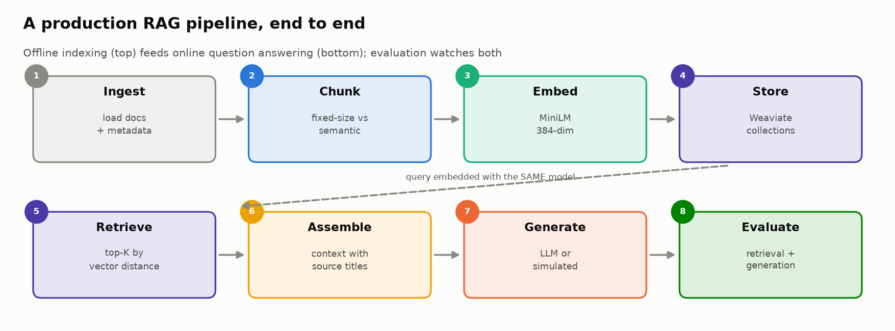
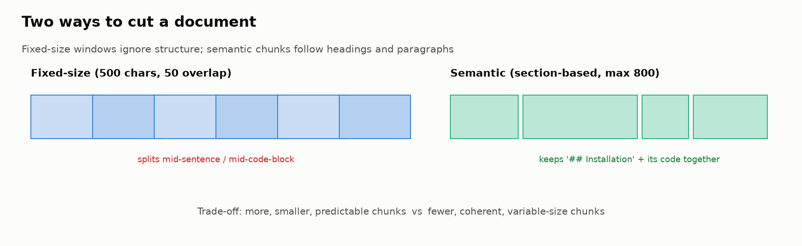
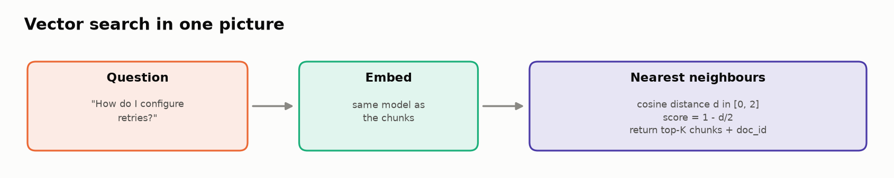
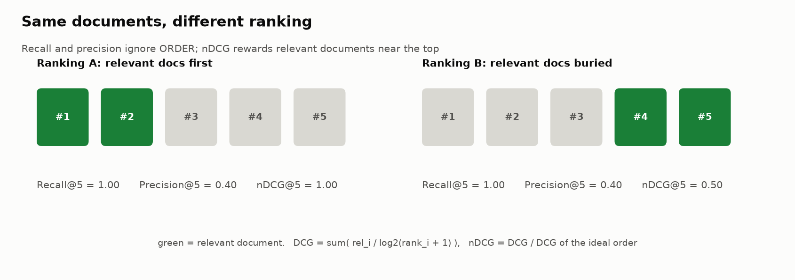

# 🏭 Module 04b: Building and Evaluating a Production-Grade RAG Pipeline

> **Lab:** [`labs/04b-production-rag-lab.ipynb`](../../labs/04b-production-rag-lab.ipynb) · **Supplemental lab after Module 04** · **Time:** 45–60 min · **Tools:** Weaviate (embedded, v4 client), `sentence-transformers`, optional OpenAI · **Keys needed:** none



---

> ### 🔗 Do I need to do Lab 04 first?
> **No.** Lab 04b has **no code dependency** on Lab 04: it builds its own corpus, index and metrics from scratch. Lab 04 evaluates a *pre-recorded* RAG system and goes deeper on faithfulness (NLI) and stress testing; Lab 04b *builds* a live pipeline and focuses on chunking, vector search and readiness.
>
> If you skip Lab 04, read **Key Concepts §4–§5** below carefully (and the lab's 📏 *Metrics primer*). They cover everything 04b assumes. If you did Lab 04, you'll notice 04b fixes its biggest limitation: here you have **corpus-level relevance labels**, so recall means what it says.

---

## 🧭 Overview

In Module 04 you evaluated a RAG system someone else ran. Here you **build one**, the way teams do in production, and evaluate every design decision you make:

1. 📂 Create a technical-documentation corpus (6 docs for a fictional product, *DataFlow*) and a **10-question evaluation set** with ground-truth answers and relevant document IDs.
2. 📦 Implement **two chunking strategies**: fixed-size with overlap, and semantic (section-aware).
3. 🧮 **Embed** chunks with `all-MiniLM-L6-v2`.
4. 🗄️ **Store** them in an embedded **Weaviate** vector database, behind a swappable adapter.
5. 🔍 **Retrieve** by vector similarity and measure Recall@5, Precision@5 and nDCG@5 for each chunking strategy.
6. 🤖 **Generate** answers (a real LLM if you have a key, otherwise an extractive simulator).
7. 📈 Score **RAGAS-style** faithfulness and answer relevancy.
8. 🎯 Make a **production-readiness** call against written thresholds.

---

## 💡 Why This Matters

The gap between a RAG demo and a RAG product is almost never the LLM. It's the **pipeline decisions** around it:

- How you cut documents into chunks decides what evidence *can* be retrieved.
- The embedding model and distance metric decide what "similar" means.
- K decides how much noise reaches the LLM.
- Without an evaluation set and thresholds, every one of those choices is a guess, and you can't tell whether a change helped or hurt.

> 🧠 **Insight from the retest:** with document-level metrics, both chunking strategies scored *identically* on every metric. The comparison only became meaningful once metrics were computed over the **retrieved chunks**. Choosing metrics that can actually **discriminate** between your options is part of evaluation design.

---

## 🎯 Learning Objectives

After this module you will be able to:

1. **Build** a modular RAG pipeline: ingest → chunk → embed → store → retrieve → assemble → generate → evaluate.
2. **Compare** fixed-size and semantic chunking and explain the trade-offs.
3. **Use** Weaviate's v4 client in embedded mode (collections, self-provided vectors, near-vector search), and explain why a storage adapter is a good production pattern.
4. **Compute** Recall@K, Precision@K and nDCG@K at chunk level with a correct ideal DCG.
5. **Explain** what RAGAS faithfulness and answer relevancy measure, and how the lab's simplified versions differ.
6. **Make** a readiness decision from written-down thresholds.

---

## 📋 Prerequisites

- 🐍 Python: dataclasses, list comprehensions, functions.
- 🧮 The idea of an embedding (text → vector; similar meaning → close vectors). Module 02 explains it.
- 🔭 Module 01 recommended (for the observability next step). Module 04 helpful, **not required**.

---

## 🧩 Key Concepts

### 1. 🏗️ Offline indexing vs. online answering

A RAG system has two pipelines that share one embedding model:

| Pipeline | When it runs | Steps |
|---|---|---|
| **Indexing (offline)** | When documents change | ingest → chunk → embed → store |
| **Answering (online)** | Every user question | embed query → search → assemble context → generate |

> ⚠️ **The same embedding model must embed both documents and queries.** Mixing models puts them in different vector spaces, and similarity becomes meaningless.

### 2. 📦 Chunking: the most impactful design decision



| Strategy | How | 👍 | 👎 |
|---|---|---|---|
| **Fixed-size** (500 chars, 50 overlap) | Slide a window over the text | Predictable size and token budget; overlap protects boundaries | Cuts sentences and code blocks mid-way; chunks mix topics |
| **Semantic** (section-based, max 800) | Split at `##` / `###` headings, then paragraphs if too big | Coherent, self-contained chunks; keeps headings with their content | Variable size; very small or very large sections |

**Overlap** repeats the last *n* characters of one chunk at the start of the next, so a sentence that straddles a boundary still appears whole in at least one chunk.

Things that commonly matter in real systems (try them as extensions): chunk size, overlap, keeping titles/metadata in every chunk, and handling code and tables specially.

### 3. 🗄️ Vector databases and Weaviate



A **vector database** stores (vector, metadata) pairs and answers **nearest-neighbour** queries fast, using an index such as **HNSW** (a navigable graph that finds approximate nearest neighbours in roughly logarithmic time).

Key Weaviate v4 ideas used in the lab:

| Concept | Lab code |
|---|---|
| **Embedded mode**: Weaviate runs inside your runtime, no server or Docker | `weaviate.connect_to_embedded()` |
| **Collections** (like tables) with typed properties | `client.collections.create("SemanticChunks", properties=[...])` |
| **Self-provided vectors**: you embed; Weaviate just stores and searches | `Configure.Vectors.self_provided()` |
| **Batch insert**, then verify the count | `col.batch.fixed_size(100)` · `aggregate.over_all(total_count=True)` |
| **Near-vector search** with distances | `col.query.near_vector(near_vector=q, limit=k, return_metadata=MetadataQuery(distance=True))` |

**Cosine distance** `d = 1 − cos(θ)` ranges over [0, 2]; the lab converts it to a similarity score with `1 − d/2`.

> 🔧 **Retest fix:** the original lab used the **v3** client (`weaviate.Client(embedded_options=...)`, `client.schema`, `client.query.get`), which no longer exists in current `weaviate-client` releases, so Task 4 crashed. The lab now uses the v4 API and was verified end-to-end against embedded Weaviate 1.30.

> 🧩 **Production pattern: the storage adapter.** All database access goes through four methods: `recreate`, `insert`, `count`, `search`. If embedded Weaviate can't start (e.g. a network blocks the binary download), the lab falls back to an in-memory numpy store with the same interface and the same cosine math. Teams use adapters like this to swap vector databases, or run unit tests without one, without touching evaluation code.

### 4. 📏 Retrieval metrics (self-contained primer)



Each evaluation question lists its `relevant_doc_ids`. The retriever returns 5 **chunks**, each tagged with the `doc_id` it came from. A chunk counts as relevant if its document is relevant.

| Metric | Lab definition | Reads as |
|---|---|---|
| **Recall@5** | relevant *documents* touched by the top-5 chunks ÷ all relevant documents | "Did we reach all the evidence?" |
| **Precision@5** | top-5 *chunks* from a relevant document ÷ 5 | "How much of the context is on-topic?" |
| **nDCG@5** | DCG ÷ ideal DCG, where DCG = Σ relᵢ / log₂(i + 1) and the **ideal** puts as many relevant chunks as actually exist at the top | "Is the good evidence ranked first?" Always between 0 and 1 |

Worked example: relevant chunks at ranks 1 and 3, and the relevant document has 3 chunks in the index:

```
DCG  = 1/log2(2) + 1/log2(4)               = 1.000 + 0.500 = 1.500
IDCG = 1/log2(2) + 1/log2(3) + 1/log2(4)   = 1.000 + 0.631 + 0.500 = 2.131
nDCG = 1.500 / 2.131                       = 0.70
```

> 🔧 **Retest fixes:** an earlier version reported **nDCG = 1.77** (impossible) because it counted duplicate chunks from the same document without adjusting the ideal, and computed precision over de-duplicated documents, which made the two chunking strategies tie on every metric. Both are fixed, and the metric cell now includes hand-checkable `assert`s. **Always test metric code on cases you can compute by hand.**

**Verified results (embedded Weaviate, default settings):**

| Metric | Fixed-size | Semantic | Winner |
|---|---|---|---|
| Recall@5 | 1.00 | 1.00 | Tie (6-doc corpus: easy to reach the right doc) |
| Precision@5 | 0.48 | **0.62** | Semantic |
| nDCG@5 | **0.66** | 0.64 | Fixed-size, narrowly |

There's no free lunch: semantic chunks fill the context with more on-topic evidence; fixed-size chunks put the single best chunk first slightly more often. Which matters more depends on your generator and your K.

### 5. ✍️ Generation metrics and RAGAS

| Metric | Question | RAGAS method (real library) | Lab's simplified version |
|---|---|---|---|
| **Faithfulness** | Are the answer's claims supported by the context? | LLM extracts claims, then checks each against the context | Share of answer words found in the context |
| **Answer relevancy** | Does the answer address the question? | LLM generates questions from the answer; compares them to the original question by embedding similarity | Question/answer word overlap, with a penalty for refusals and very short answers |
| **Context precision / recall** | Is the retrieved context relevant / complete for the answer? | LLM-judged per chunk | (covered by your retrieval metrics) |

> ⚠️ **Read faithfulness with suspicion in this lab.** Without an API key, the generator is **extractive**: it copies the two context sentences that best match the question. It is faithful *by construction* (≈ 0.98). A high score here says more about the generator's design than about quality. With a real LLM, faithfulness is the metric that drops, and word overlap is a weak detector (Module 04 shows a "12 → 16 weeks" distortion scoring 0.53).

### 6. 🎯 Production readiness

Thresholds are **product decisions**. Write them down *before* looking at results:

| Metric | Minimum | Target | Verified result (semantic) |
|---|---|---|---|
| Recall@5 | 0.70 | 0.85 | 1.00 ✅ |
| Precision@5 | 0.25 | 0.40 | 0.62 ✅ |
| Faithfulness | 0.75 | 0.90 | 0.98 ✅ (see caveat) |
| Answer relevancy | 0.65 | 0.80 | 0.70 ⚠️ |

Overall: **CONDITIONAL**. Before you act on that warning, ask whether the *answers* are off-topic or whether a word-overlap proxy is a poor measure of relevancy. Diagnosing your metric is part of the decision.

---

## 🧪 Example Walkthrough

```python
# Index
fixed_chunks    = fixed_size_chunking(DOCUMENTS, chunk_size=500, overlap=50)
semantic_chunks = semantic_chunking(DOCUMENTS, max_chunk_size=800)
store.recreate("SemanticChunks")
store.insert("SemanticChunks", objects, embed_texts([c.content for c in semantic_chunks]))

# Retrieve for one eval question
q = EVALUATION_DATASET[3]                     # "How do I configure retries for failed tasks?"
hits = retrieve(q["question"], "SemanticChunks", top_k=5)
doc_ids = [h.doc_id for h in hits]            # e.g. ['doc-004', 'doc-004', 'doc-003', 'doc-004', 'doc-004']

compute_recall_at_k(doc_ids, q["relevant_doc_ids"])       # 1.0  (reached doc-004)
compute_precision_at_k(doc_ids, q["relevant_doc_ids"])    # 0.8  (4 of 5 chunks on-topic; verified run)
compute_ndcg_at_k(doc_ids, q["relevant_doc_ids"], 5, n_relevant_chunks("SemanticChunks", q["relevant_doc_ids"]))

# Generate + score
resp = rag_pipeline(q["question"], "SemanticChunks", top_k=5)
evaluate_faithfulness(resp.answer, resp.context_used), evaluate_answer_relevancy(q["question"], resp.answer)
```

*(Exact doc orderings can vary slightly with model versions; the metric logic doesn't.)*

---

## ⚠️ Common Mistakes or Misunderstandings

| ❌ Mistake | ✅ Instead |
|---|---|
| Copying a v3 Weaviate tutorial (`weaviate.Client(...)`, `client.schema`) | Use v4: `connect_to_embedded()` / `connect_to_weaviate_cloud()` and `client.collections` |
| Embedding queries with a different model than documents | Same model, same normalization, for both |
| Assuming batch inserts succeeded | Check `failed_objects` and verify the count |
| Picking a chunking strategy by intuition | Measure on *your* eval set; check several metrics |
| Using metrics that can't move | If every option ties, your metric isn't discriminating; change granularity |
| nDCG > 1 and nobody notices | Sanity-check ranges; unit-test metrics on hand-computed cases |
| Trusting faithfulness from an extractive generator | It's faithful by construction; use a real LLM before concluding anything |
| Calling a simplified metric "RAGAS" | Say "RAGAS-style"; the real library uses LLM judging |
| Setting thresholds after seeing results | Write thresholds first, so goalposts can't move |

---

## 🚀 Before You Start the Lab

- ⏳ First run downloads the embedding model (~90 MB) and the embedded Weaviate binary. Allow 1–2 minutes.
- 🔄 If you re-run Task 4 in the same session and Weaviate complains about startup, run the **Clean up** cell (or restart the runtime) first.
- 🔑 Optional: add `OPENAI_API_KEY` to Colab Secrets to use `gpt-4o-mini` for generation, then compare faithfulness with the simulated generator.
- 🤔 Before Task 6, write down your prediction: which chunking strategy wins on precision? On nDCG?

---

## 🔑 Key Takeaways

1. 🏗️ **RAG quality is mostly pipeline design:** chunking, embeddings, K and context assembly.
2. 📦 **Chunking trades coherence for predictability**, and the "winner" depends on the metric.
3. 🗄️ **Use the current vector-DB client and an adapter.** Deprecated APIs break labs and products alike.
4. 📏 **Compute retrieval metrics at the granularity that discriminates**, with a correct ideal for nDCG, and test them by hand.
5. ✍️ **Know what your generation metrics really measure.** Simplified overlap metrics are teaching tools, not production judges.
6. 🎯 **Write thresholds first**, then let the weakest metric drive a GO / CONDITIONAL / NO-GO call.
7. 🔭 **Next production step:** trace retrieval and generation as separate observations (Module 01) and monitor these metrics on live traffic (Module 08).

---

## 🧠 Self-Check

<details>
<summary>1. Why can Recall@5 be 1.0 for every question while Precision@5 varies?</summary>

Recall asks whether each relevant *document* was reached at least once; with 6 docs that's easy. Precision counts how many of the 5 *chunks* are from relevant documents, which depends on chunking and ranking.
</details>

<details>
<summary>2. What breaks if the query is embedded with a different model than the chunks?</summary>

The vectors live in different spaces, so cosine distances are meaningless and retrieval becomes effectively random.
</details>

<details>
<summary>3. Why is the lab's faithfulness score near 1.0 without an API key, and why shouldn't you celebrate?</summary>

The simulated generator only copies sentences from the context, so its words are always found in the context. It measures the generator's design, not answer quality.
</details>

<details>
<summary>4. Name one benefit of the VectorStore adapter beyond the in-memory fallback.</summary>

You can swap vector databases (Weaviate → pgvector → Pinecone) or run fast unit tests of evaluation code without changing any evaluation logic.
</details>

---

## 📖 Glossary

**Chunk** · a retrievable unit of a document. **Overlap** · characters shared between consecutive chunks. **Embedding model** · text → vector. **Vector database** · stores vectors and answers nearest-neighbour queries. **HNSW** · graph-based approximate nearest-neighbour index. **Embedded mode** · database running inside your process/runtime. **Collection** · Weaviate's equivalent of a table. **Cosine distance** · 1 − cosine similarity. **RAGAS** · an open-source RAG evaluation library using LLM judges. **Readiness threshold** · the minimum/target value a metric must meet to ship.
