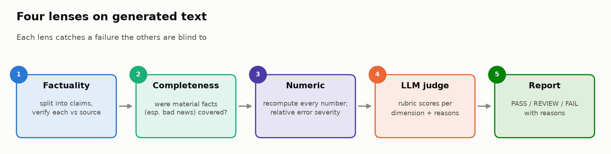
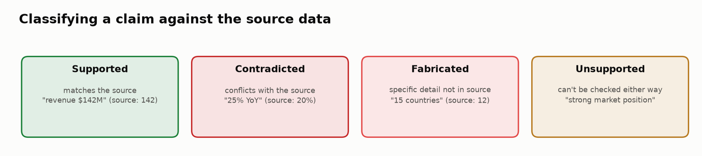
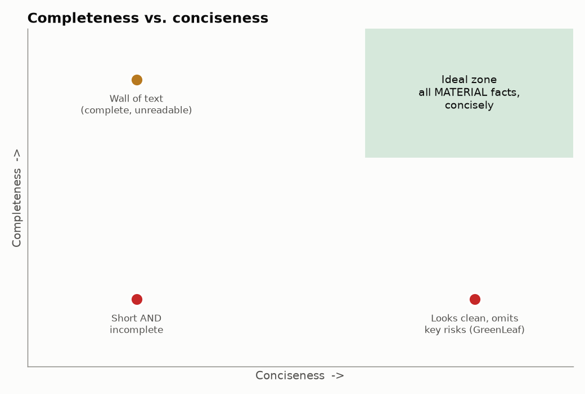
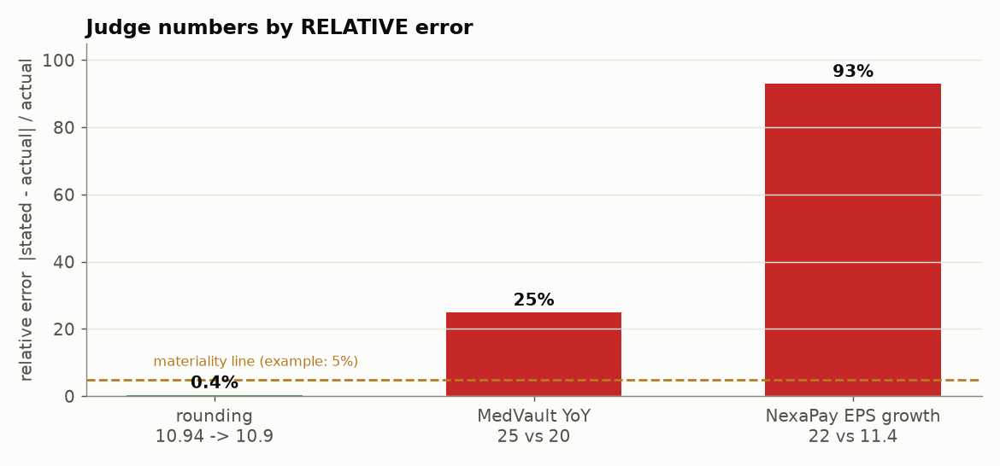
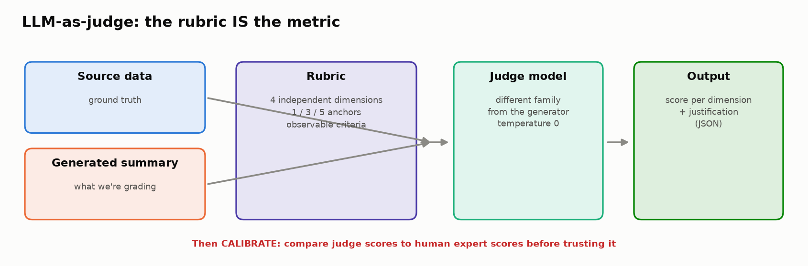

# ✍️ Module 05: Evaluating Generative Outputs

> **Lab:** [`labs/05-generative-outputs-lab.ipynb`](../../labs/05-generative-outputs-lab.ipynb) · **Time:** 25–30 min · **Tools:** Python, `pandas`, `re` · **Keys needed:** none (the LLM judge uses recorded responses)



---

## 🧭 Overview

Free-form text is the hardest output to evaluate: there's no schema, no single right answer, and the most dangerous errors are written in the most convincing prose.

In this module you'll evaluate LLM-written **quarterly earnings summaries** for six companies, sent to portfolio managers who make investment decisions from them. You'll build four complementary evaluators and combine them into a publish decision:

| Lens | Question | Catches |
|---|---|---|
| 🔍 **Factuality** | Is what it says true? | Fabricated and contradicted claims |
| ✅ **Completeness** | Does it say everything it should? | Material omissions, especially bad news |
| 🔢 **Numeric reasoning** | Is every number right? | Mis-calculated growth rates, invented figures |
| ⚖️ **LLM-as-judge** | Is it good overall, by a rubric? | Misleading framing, holistic quality |

---

## 💡 Why This Matters

Two real-world-style incidents frame the lab:

- 📈 A summary said revenue grew **15%**; the data said **8%**.
- 🙈 A summary omitted a **debt covenant waiver**, a serious risk signal.

The first is a *fabrication*; the second is an *omission*. In finance (and medicine, law, compliance), omissions can be just as harmful as false statements: a summary can be **100% factually accurate and still deeply misleading**. GreenLeaf Energy in the lab is exactly that: every stated fact checks out, yet it hides a net-income collapse, $220M of debt, a covenant waiver and a CEO departure behind phrases like "healthy margins".

> 🧠 **The core idea:** generative evaluation is **multi-dimensional by necessity**. No single score (BLEU, ROUGE, "rate it 1–10") captures "true, complete, numerically sound, and fairly framed".

---

## 🎯 Learning Objectives

After this module you will be able to:

1. **Decompose** generated text into atomic claims and verify each against source data.
2. **Distinguish** fabrication, distortion and conflation, and classify claims as supported / contradicted / fabricated / unsupported.
3. **Design** completeness criteria that weight critical (especially negative) facts more heavily.
4. **Verify** numbers using **relative error** and severity tiers.
5. **Write** a structured LLM-judge rubric with independent dimensions and anchored score levels.
6. **Meta-evaluate** a judge against human scores, looking beyond overall agreement to bias and reasons.
7. **Combine** dimensions into PASS / REVIEW / FAIL decisions with explicit reasons.

---

## 📋 Prerequisites

- ✅ Modules 01–02 (scores, evaluators, *unsupported claim* as a failure category).
- 📊 Basic financial vocabulary helps (revenue, net income, EPS, YoY/QoQ growth, margin), but the lab explains what matters.
- 🐍 Python strings and regex basics.

---

## 🧩 Key Concepts

### 1. 🧬 Claim extraction: the unit of factuality

You can't verify a paragraph; you verify **claims**. Claim extraction splits text into atomic, checkable statements:

> "Revenue grew 8.5% YoY to $89M, and operating margin remained healthy at 12.4%."
> → ① revenue = $89M ② YoY growth = 8.5% ③ operating margin = 12.4% ④ *"healthy"* (a judgment, not a fact)

The lab uses sentence splitting plus keyword/number matching. Production systems typically use an LLM to extract claims and an LLM or NLI model to verify each (the same idea as RAGAS faithfulness).

### 2. 🏷️ Claim labels and hallucination types



| Hallucination type | What happens | Example |
|---|---|---|
| **Fabrication** | Details that don't exist in the source | "15 new countries" (source: 12) |
| **Distortion** | A real fact with wrong details | "25% YoY growth" (source: 20%) |
| **Conflation** | Mixing periods or entities | Q2 numbers presented as Q3 |

Factuality score = supported claims ÷ all extracted claims. Note what that means for **unsupported** claims (neither confirmed nor refuted): they lower the score without being proven wrong. Decide deliberately how to treat them.

> 🔎 **Verified-run insight:** the lab's keyword verifier flags NexaPay's "15 countries" (contradicted) but **misses** MedVault's "25% YoY", because it can't link that sentence to the growth metric. The numeric layer catches it. That's a concrete example of why you layer evaluators: each has false negatives.

### 3. ✅ Completeness: what's missing matters



Each summary comes with a list of **key facts** it should cover. Completeness = weighted coverage, with **critical facts weighted 2×**:

```
completeness = Σ weight(covered facts) / Σ weight(all key facts)
```

| Summary | Facts covered | Completeness | Critical omissions |
|---|---|---|---|
| TechFlow | 10 / 10 | 1.00 | 0 |
| **GreenLeaf** | 4 / 10 | **0.31** | **5** (net-income collapse, $220M debt, cash vs. debt, covenant waiver, CEO exit) |
| MedVault | 11 / 11 | 1.00 | 0 |
| **UrbanLogix** | 6 / 10 | **0.50** | **4** (widening loss, negative margin, debt, 15% layoffs) |
| NexaPay | 11 / 11 | 1.00 | 0 |
| SkyBridge | 9 / 10 | 0.82 | 1 ($340M debt) |

**Completeness ≠ length.** A concise summary covers all **material** facts efficiently; an incomplete one skips material facts to *look* clean. And the **negative-information rule**: omitting bad news should cost more than omitting good news, because one-sided summaries mislead decisions.

### 4. 🔢 Numeric reasoning



LLMs don't calculate; they predict plausible-looking numbers. So recompute every number from the source and compare with **relative error**:

```
relative_error = |stated − actual| / |actual|
```

| Tier (lab) | Meaning | Example |
|---|---|---|
| ✅ exact / within rounding | fine | 10.9% for 10.94% |
| ⚠️ minor | small, usually acceptable | 6.1% for 6.06% (0.7% rel.) |
| ❌ major | material misstatement | 25% for 20% (25% rel.); 22% for 11.4% (**93%** rel.) |
| 🔴 fabricated | number with no source | invented figures |

Why relative, not absolute? "5 percentage points" sounds small, but 25% vs. 20% overstates growth by a **quarter**, enough to change an investment thesis.

### 5. ⚖️ LLM-as-judge and rubric design



An LLM judge reads the source, the summary and a **rubric**, then returns scores with justifications. **The rubric is the metric:** vague rubrics produce vague, inconsistent scores.

A good rubric (Task 7 asks for exactly 4 dimensions):

- **Independent dimensions** that don't double-count (e.g. Factual Accuracy, Completeness & Risk, Numeric Reasoning, Balanced Framing).
- **Anchored levels**: concrete, observable descriptions for at least 1, 3 and 5.
- **Anchor examples**: what a 1 and a 5 look like for *this* task.
- **Structured output** (JSON per dimension + justification) so you can parse and audit it.

Example dimension:

| Score | Balanced Framing |
|---|---|
| 5 | Tone matches the data; negatives stated as plainly as positives |
| 3 | Mostly neutral; some optimistic wording on mixed results |
| 1 | Misleadingly positive; declining metrics described as "healthy" |

Practical judge hygiene: use a judge from a **different model family** than the generator, temperature 0, ask for evidence in the justification, and **version** the prompt.

### 6. 🧪 Meta-evaluation: evaluating the judge

Comparing the judge with human experts (Task 9) is how you learn where to trust it. In the verified run:

| Company | Human | Judge | Gap |
|---|---|---|---|
| TechFlow | 5.0 | 4.75 | −0.25 |
| GreenLeaf | 2.0 | 2.50 | +0.50 |
| MedVault | 3.0 | 3.50 | +0.50 |
| UrbanLogix | 2.0 | 2.50 | +0.50 |
| NexaPay | 3.0 | 3.25 | +0.25 |
| SkyBridge | 4.0 | 4.25 | +0.25 |

Pearson correlation ≈ **0.99**, and all within ±0.75: "full agreement". But look closer:

- **Systematic bias:** 5 of 6 gaps are **positive**. The judge is consistently *more lenient* than the expert. Correlation is blind to a constant offset.
- **Reasons can disagree even when scores agree:** check whether the judge's dimension scores point at the same problems the human cares about.
- **Gates vs. judges:** SkyBridge scores well with both judge and human, yet **fails** the combined report on one critical omission (its $340M debt). A hard rule is stricter than either holistic score. Is that what you want?

Other well-known judge biases: **verbosity** (longer looks better), **position** (in pairwise comparisons, first or second gets favored), **self-preference** (judges favor outputs from their own model family).

### 7. 📋 Combining into decisions

The lab's combined report gives each summary a decision with reasons. Verified result: **1 PASS (TechFlow), 0 REVIEW, 5 FAIL**:

| Company | Decision | Reason |
|---|---|---|
| TechFlow | 🟢 PASS | — |
| GreenLeaf | 🔴 FAIL | 5 critical omissions |
| MedVault | 🔴 FAIL | 1 major numeric error |
| UrbanLogix | 🔴 FAIL | 4 critical omissions |
| NexaPay | 🔴 FAIL | 2 major numeric errors |
| SkyBridge | 🔴 FAIL | 1 critical omission |

The failure-pattern analysis then turns this into **system improvements**: a numeric verification gate, a completeness checklist for risk items, framing-bias detection, judge calibration, and tiered human review.

---

## 🧪 Example Walkthrough: GreenLeaf Energy

> "GreenLeaf Energy posted Q3 2025 revenue of $89M, growing 8.5% year-over-year. Operating margin remained healthy at 12.4%. EPS came in at $0.38. The company has $45M in cash…"

| Lens | Result | Why |
|---|---|---|
| 🔍 Factuality | 0.57: no contradictions | Every stated number is right |
| ✅ Completeness | **0.31**, 5 critical omissions | Hides the decline, debt, waiver, CEO exit |
| 🔢 Numeric | 4/4 correct | 8.5% YoY is right (8.54%) |
| ⚖️ Judge | 2.50 (Factual 4, Completeness 1, Numeric 4, **Framing 1**) | "Healthy margin" while deteriorating |
| 📋 Decision | 🔴 **FAIL** | Critical omissions |

A factuality-only evaluator would have shipped it.

---

## ⚠️ Common Mistakes or Misunderstandings

| ❌ Mistake | ✅ Instead |
|---|---|
| "All the facts are right, so it's good." | Also check completeness and framing; omission can mislead. |
| Scoring whole paragraphs | Extract atomic claims and verify each. |
| Treating all numeric errors equally | Use relative error and severity tiers. |
| "Rate the quality 1–10" as a judge prompt | Independent dimensions, anchored levels, structured output. |
| Trusting a judge because correlation is high | Check bias direction, reasons, and calibrate on labelled data. |
| Using the generator model as its own judge | Prefer a different model family. |
| Equal weights for good and bad news | Weight critical, especially negative, facts higher. |
| Averaging all dimensions into one score | Decide with gates and reasons; report dimensions. |

---

## 🚀 Before You Start the Lab

- 📖 Skim the **source data** for GreenLeaf before Task 3; the lab hinges on what the summary leaves out.
- ✍️ Tasks 5 and 7 are **design** tasks with no single right answer. Commit to your criteria *before* you see the reference implementation.
- 🔍 Keep a note of every place an automated layer **misses** something you can see. That list *is* your answer to the stretch goal.

---

## 🔑 Key Takeaways

1. 🔍 **Factuality ≠ completeness.** GreenLeaf is accurate and misleading at the same time.
2. 🧬 **Verify claims, not paragraphs**, and decide explicitly how to treat unsupported claims.
3. 🔢 **Recompute numbers; judge by relative error.** LLMs predict numbers, they don't calculate them.
4. ⚖️ **The rubric is the metric.** Independent dimensions + anchored levels + structured output.
5. 🧪 **Meta-evaluate your judge:** high correlation can hide systematic leniency.
6. 🧱 **Layer your evaluators.** Each one missed something another caught.
7. 📋 **End in a decision with reasons**, then turn failure patterns into system fixes.

---

## 🧠 Self-Check

<details>
<summary>1. A summary has a factuality score of 1.0 and completeness of 0.3. What kind of failure is this?</summary>

An omission failure: everything stated is true, but material information (often negative) is missing. It's misleading by selection.
</details>

<details>
<summary>2. Stated growth 22%, actual 11.4%. Absolute and relative error?</summary>

Absolute: 10.6 percentage points. Relative: 10.6 / 11.4 ≈ 93%. The summary nearly doubles the real growth.
</details>

<details>
<summary>3. Judge–human correlation is 0.99. Name a problem correlation can't detect.</summary>

A constant bias (e.g. the judge is always 0.5 higher). Correlation measures linear association, not agreement in absolute value.
</details>

<details>
<summary>4. Why should a judge come from a different model family than the generator?</summary>

To reduce self-preference bias: models tend to rate text in their own style more favorably.
</details>

---

## 📖 Glossary

**Claim** · an atomic, checkable statement. **Fabrication / distortion / conflation** · invented, altered, or mixed-up facts. **Supported / contradicted / unsupported** · verified true / verified false / uncheckable. **Completeness** · weighted coverage of material facts. **Relative error** · |stated − actual| / |actual|. **Rubric** · dimensions plus anchored score levels. **Meta-evaluation** · evaluating an evaluator. **Leniency bias** · a judge scoring systematically higher than experts.
