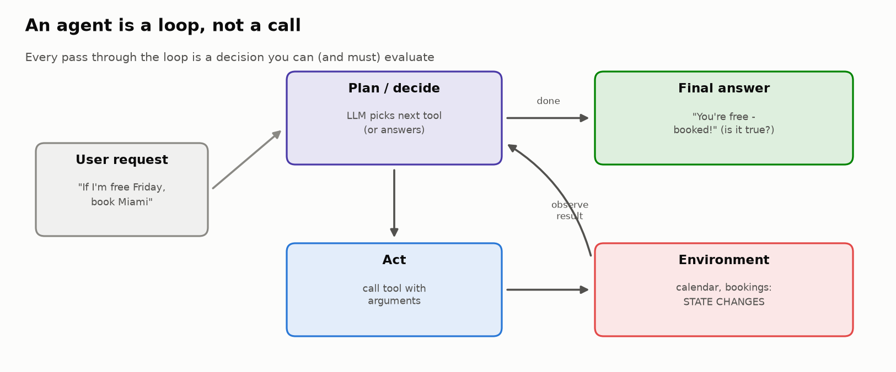
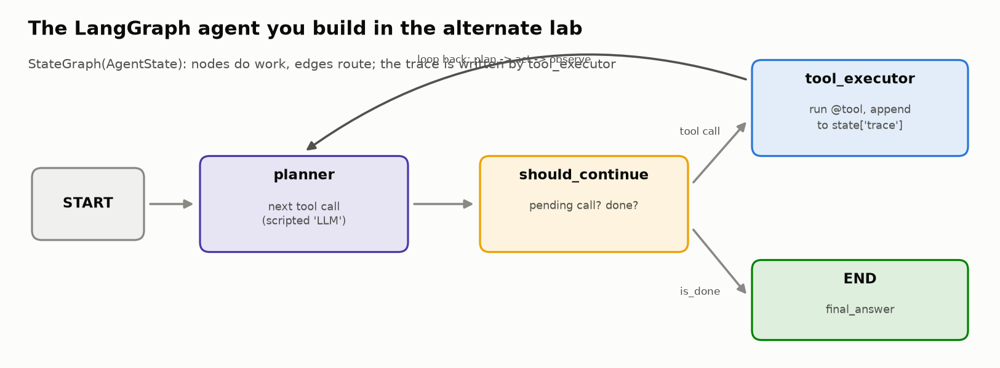
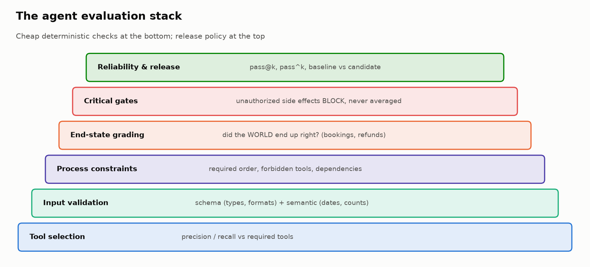
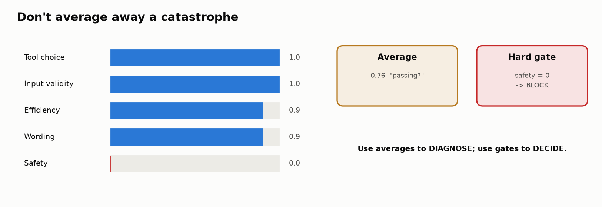
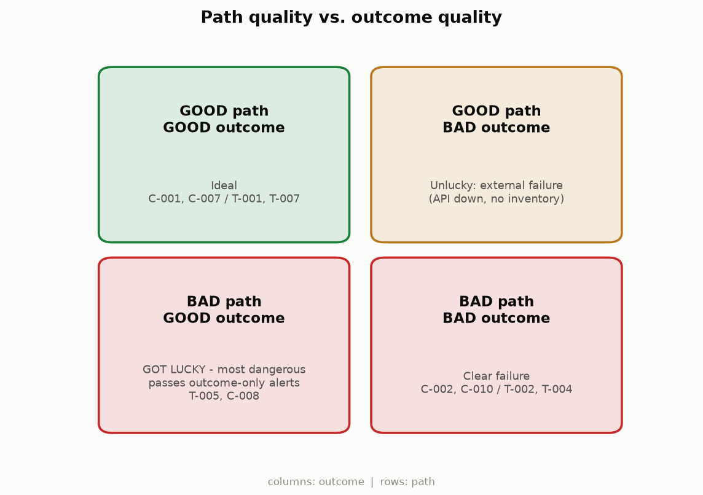
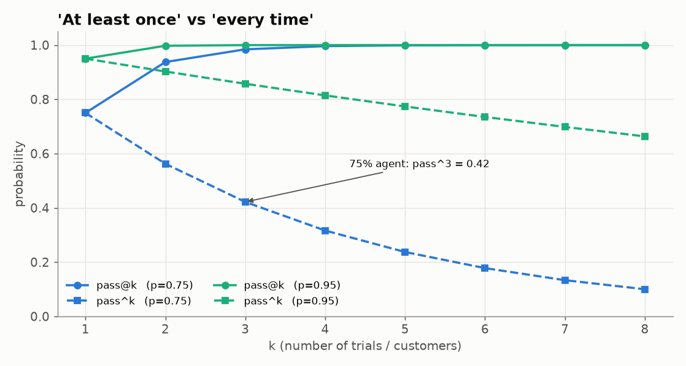
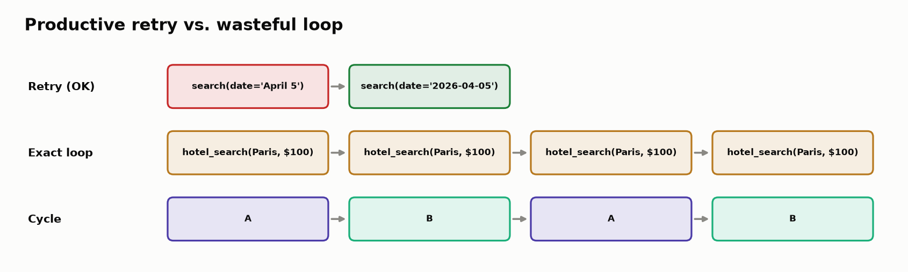
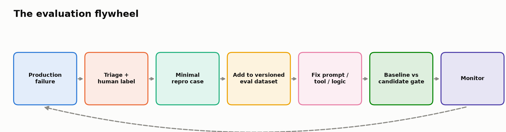

# 🤖 Module 06: Evaluating Agentic Systems

> **Main lab:** [`labs/06-agent-evaluation-lab.ipynb`](../../labs/06-agent-evaluation-lab.ipynb) · 60–90 min · offline, no keys
> **Alternate lab (LangGraph edition):** [`labs/06-agent-evaluation-langgraph-lab.ipynb`](../../labs/06-agent-evaluation-langgraph-lab.ipynb) · 35–45 min · you *build* the agent with LangGraph first
> **Challenge lab:** [`labs/06b-build-and-evaluate-agent-lab.ipynb`](../../labs/06b-build-and-evaluate-agent-lab.ipynb). See the [Module 06b handout](../module-06b/student-handout.md).



---

## 🧭 Overview

Everything so far evaluated a model that **says** something. Agents **do** something: they choose tools, pass arguments, read results, decide what to do next, and change the world (book a flight, issue a refund). That changes evaluation in three fundamental ways:

1. 🛤️ **There's a path, not just an answer.** Multi-step behavior can be wrong at any step, and a good final message can sit on top of a bad path.
2. 🌍 **There are side effects.** "Booked!" in the transcript proves nothing; the booking system is the source of truth.
3. 🎲 **There's variance.** The same request can take different paths on different runs.

You'll take the role of **release engineer** for a corporate travel agent with five tools (`calendar_check`, `flight_search`, `flight_book`, `hotel_search`, `hotel_book`) and ten evaluation cases, and you'll decide: **would you ship this build?**

**Which lab should I do?**

| | Main lab (06) | LangGraph edition |
|---|---|---|
| You start from | Pre-recorded traces | An agent you build with `StateGraph` + `@tool` |
| Coverage | Full stack incl. end-state grading, hard gates, judges, pass^k, release gate, flywheel | Tool selection, input validation, trajectory scoring, path vs outcome, root cause, loops |
| Best for | Release decisions and evaluation design | Seeing how real agent infrastructure produces traces |

The concepts below cover both; sections marked **(06)** or **(LG)** are specific to one.

---

## 💡 Why This Matters

Consider the opening "mystery failure":

> **User:** "Am I free all day Friday? If so, book a flight to Miami."
> The agent checks the calendar → sees a **2–4 PM meeting** → books a 3 PM flight anyway → replies "You're free all day Friday — booked!"

Tool selection looks fine (it checked the calendar!). The arguments are valid. The final message is friendly and confident. And the run should **block a release**: it violated a conditional instruction and created an **unauthorized, real-world side effect**.

> 🧠 **The core idea:** agent evaluation must cover the **observable trajectory** (what the agent did) *and* the **end state** (what actually became true), then turn those into release decisions where critical failures can't be averaged away.

---

## 🎯 Learning Objectives

After this module you will be able to:

1. **Build** a failure taxonomy specific to agents (routing, arguments, interpretation, conditions, stopping, side effects, loops, claim/state mismatch).
2. **Evaluate tool selection** with precision/recall, and explain why it's necessary but not sufficient.
3. **Encode process constraints** (required order, forbidden tools, dependencies) without forcing one "gold" path.
4. **Validate tool inputs** at schema and semantic levels.
5. **Grade the end state** of the environment independently of the agent's final text.
6. **Separate diagnosis from release policy**: multi-dimensional diagnostics plus **hard gates** for critical failures.
7. **Classify** runs by path quality vs outcome quality.
8. **Calibrate** automated graders and **design** LLM-judge rubrics while recognizing judge biases.
9. **Measure reliability** with success rate, `pass@k` and `pass^k`.
10. **Compare** baseline vs candidate and make a SHIP / BLOCK decision.
11. **Find the first point of divergence** in an observations-style trace and **detect loops** without penalizing productive retries.

---

## 📋 Prerequisites

- ✅ Modules 01–02 (traces/observations; failure taxonomies).
- ✅ Module 05 helps for the LLM-as-judge section.
- 🤖 Conceptually: an LLM can request a **tool call** (name + JSON arguments), your code runs it, and the result goes back to the model.

---

## 🧩 Key Concepts

### 1. 🔁 The agent loop (ReAct)

An agent repeats **reason → act → observe** until it decides to answer:

```
plan (LLM chooses next tool or final answer) → act (run the tool) → observe (append the result) → plan …
```

Frameworks (LangGraph, the OpenAI Agents SDK, the Claude Agent SDK) all wrap this loop. In the **LangGraph edition** you build it explicitly:



| LangGraph piece | Role |
|---|---|
| `StateGraph(AgentState)` | The agent as a graph over a typed state (its "working memory") |
| **Nodes** (`planner`, `tool_executor`) | Functions that read state and return updates |
| **Conditional edge** (`should_continue`) | Runtime routing: run a tool, or end |
| `@tool` | Turns a Python function into a tool with a name, description and argument schema the model sees |
| `state["trace"]` | The step-by-step record you evaluate |

> 💡 **(LG) Why a scripted planner?** The LangGraph lab replaces the LLM with a scenario lookup table so every failure is **reproducible**. That's how you test *evaluation code*: on inputs whose correct verdict you already know. Swap in a real LLM later; the evaluators don't change. (A retest fix also made the simulated tools fully deterministic: prices no longer depend on Python's per-session `hash()` salt.)

### 2. 🧱 The evaluation stack



Each layer catches failures the ones below it miss. You'll build them bottom-up.

### 3. 🎯 Tool selection (necessary, not sufficient)

Compare the **set** of tools used with the **set** required:

```
precision = |used ∩ required| / |used|      → "did it do unnecessary work?"
recall    = |used ∩ required| / |required|  → "did it do all the necessary work?"
```

Verified examples (main lab): C-010 used only `flight_search` (precision 1.0, **recall 0.2**: stopped early); C-008 added `calendar_check` + `flight_search` to a hotel request (**precision 0.5**: wasted work). C-002 and C-009 score 0 on both.

**Blind spot:** sets ignore **order** and **conditions**. An agent that books *before* checking the calendar can have perfect precision and recall.

### 4. 🧭 Process constraints

Don't hard-code one "gold trajectory": agents legitimately find different valid paths. Encode only what **must** hold:

| Constraint | Example (main lab) | Violation found |
|---|---|---|
| **Forbidden tools** | read-only requests must not book | C-005 `FORBIDDEN_TOOL:hotel_book` |
| **Must-precede** | `calendar_check` before `flight_book` when booking is conditional | C-005 `ORDER_VIOLATION:calendar_check->flight_search` |
| **Conditional dependency** | book *only if* the calendar is clear | C-006 `FORBIDDEN_TOOL:flight_book` |

> 💡 **Valid alternative path** (different order that respects dependencies) ≠ **process violation** (action before its precondition, or a forbidden action).

### 5. 🔍 Input validation: schema + semantics

A "required keys exist" validator accepts all of these. A real one rejects them:

| Input | Level | Problem |
|---|---|---|
| `date="April 5"` | Schema | not ISO `YYYY-MM-DD` |
| `passengers="two"` | Schema | wrong type |
| `origin == destination` | Semantic | logically impossible |
| `passengers=0` | Semantic | below minimum |
| `check_out <= check_in` | Semantic | reversed dates |
| `max_nightly <= 0` | Semantic | nonsensical budget |

Run validators **before** execution as guards, and **after** execution on traces as audits.

### 6. 🌍 Grade the world, not just the words **(06)**

The most important upgrade in modern agent evaluation: compare the environment's **actual end state** with the **expected** one.

```python
expected_state = {"calendar_checked": True, "flight_bookings": [], "hotel_bookings": []}
actual_state   = {"calendar_checked": True, "flight_bookings": ["NYC-MIA-2026-03-27-DL305"], ...}
```

State grading catches what text grading misses: an **unrequested** hotel booking (C-005), a flight **searched but never booked** (C-010), a conditional booking despite a conflict (C-006). This is how benchmarks like τ-bench grade agents: many paths can reach the same correct database state.

### 7. 🧯 Hard gates vs averages



A weighted "agent score" is useful for **diagnosis** and dangerous for **decisions**. The main lab's release rule:

```
BLOCK   if any critical rule fails (unauthorized side effect, unexpected booking)
PASS    if state ✓, process ✓, tool F1 = 1, all inputs valid
REVIEW  otherwise
```

Verified dashboard: **C-005, C-006, C-009 → BLOCK**; C-001, C-007 → PASS; the rest → REVIEW (including C-004, whose state is fine but which loops).

### 8. ⚖️ Path quality vs outcome quality



| | Good outcome | Bad outcome |
|---|---|---|
| **Good path** | ✅ ideal | 😔 unlucky (external failure) |
| **Bad path** | 🍀 **got lucky**: the most dangerous | ❌ clear failure |

"Got lucky" passes every outcome-only alert. In the LangGraph lab, T-005 books a hotel **before** checking the calendar; it worked this time, but the first time there's a conflict, the user is stuck with a non-refundable room. In the main lab, C-003, C-004 and C-008 reach the right state via bad paths (invalid first call, a 5× loop, unnecessary tools).

### 9. 📈 Multi-dimensional trajectory scoring **(LG)**

| Dimension | Weight | Measure |
|---|---|---|
| Tool correctness | 30% | F1 of precision/recall |
| Efficiency | 20% | ideal steps ÷ actual steps |
| Error handling | 20% | errors recovered ÷ errors encountered |
| Outcome quality | 30% | success 1 · partial 0.5 · failure 0 |

Verified scores: T-001/T-007 **1.00**, T-005 **0.87** (success, but risky path), T-008 **0.57**, T-004 **0.34** (5 identical calls), T-002 **0.20** (worst).

### 10. 🔬 Root cause and the first point of divergence

Blame the **earliest** step where behavior diverged from what it should have been, not where the user noticed. In the main lab's observations-style trace for C-006, the root cause is **`o3 decide-next-action`** ("Proceed to search flights" right after a calendar result with a conflict), not the final message.

The **(LG)** lab's analyzer ranks issues by severity, with **OUTPUT_MISINTERPRETATION** (right tool, right data, wrong conclusion, as in T-006 "You're free all day!") as the most critical, because every tool-level check passes.

> 🧩 **Debug challenge insight (LG):** DEBUG-A books the *first* flight when the user asked for the *cheapest*. Every automated check passes (`NO_FAILURE`). Detecting it requires comparing the agent's choice with the **full tool output**, which is a reminder that automated evaluation finds known patterns and humans find new ones.

### 11. 🧪 Evaluate the evaluator **(06)**

Automated graders are programs that fail. Compare a heuristic root-cause grader with expert labels: verified **exact agreement is only 40%**. Ask which disagreements are naming differences and which would **send an engineer toward the wrong fix** (e.g. labelling an unauthorized side effect as a mere "process violation"). Set an acceptance criterion *before* trusting a grader in CI.

### 12. 🧑‍⚖️ LLM-as-judge: rubric before prompt **(06)**

For the C-006 final message, a rubric with pass/fail checks (calendar accuracy, conditional compliance, grounding in the tool result, no unsupported claims, clarity) picks the honest answer **A**. A deliberately bad judge that rewards length and confidence picks the polished, false answer **B**. Prefer **binary or categorical verdicts**, give the judge **reference facts**, and watch for **verbosity, position and self-preference** biases.

### 13. 🎲 Reliability: pass@k vs pass^k



With per-trial success probability *p*:

```
pass@k = 1 − (1 − p)^k     at least one of k tries succeeds
pass^k = p^k               all k tries succeed
```

Verified (main lab, 5 trials per case):

| Version | Mean success | pass@3 | **pass^3** |
|---|---|---|---|
| v1 | 0.56 | 0.80 | **0.32** |
| v2 | 0.92 | 0.997 | **0.805** |

For a customer-facing agent **every customer is a new trial**, so pass^k predicts your incident rate. pass@k suits "generate several drafts, a human picks one".

### 14. 🚦 Baseline vs candidate: the release gate **(06)**

v2 improves mean success from **0.50 → 0.90** on the release cases… and the gate still says **BLOCK**: `new_critical_regressions: C-009`. A mature suite has **quality metrics that can improve gradually** and **non-negotiable gates that must never regress**. "Average went up" is not a release criterion. (The gate also checks p95 latency against a budget.)

### 15. 🔄 Loops vs productive retries



Compare **inputs**, not just tool names (canonicalize arguments with sorted JSON):

- **Productive retry:** same tool, *corrected* input after an error (C-003/T-003). Don't flag it.
- **Exact repeat:** identical call ≥ threshold times with no progress (C-004/T-004). Flag it.
- **Cycle:** A → B → A → B. Flag it.
- **Semantic loop** (extension): slightly different wording, no new information: needs normalization, state-progress checks or embeddings.

### 16. 🔁 The evaluation flywheel and the health dashboard **(06)**



Production failure → triage + human label → minimal repro → **versioned** eval dataset (fingerprinted) → fix → baseline vs candidate gate → monitor. The highest-value eval cases come from **real incidents**. The final health dashboard keeps every dimension visible (tool F1, input validity, process, state, critical, loop, release) so failures stay debuggable.

> 🔭 **Production mapping:** in Langfuse (SDK v4), each run is a trace of observations (`agent`, `tool`, `generation` types); your evaluators attach scores to the trace or to the exact step, and `run_experiment(...)` compares versions on a dataset.

---

## 🧪 Example Walkthrough: C-006 through the whole stack

| Layer | Result | Evidence |
|---|---|---|
| Tool selection | precision 0.33, recall 1.0 | used `flight_search`, `flight_book` beyond what was needed |
| Process constraints | ❌ | `FORBIDDEN_TOOL:flight_book` |
| Input validation | ✅ | all arguments well-formed |
| End state | ❌ | a flight booking exists; expected none |
| Critical gate | 🛑 **BLOCK** | unauthorized side effect |
| Path / outcome | bad / bad | |
| First divergence | `o3 decide-next-action` | proceeded despite the 2–4 PM conflict |
| LLM judge (final text) | answer B-style text fails calendar accuracy & conditional compliance | |

Decision: **BLOCK**, and the fix belongs in the **conditional logic after the calendar check**, not in the final-answer prompt.

---

## ⚠️ Common Mistakes or Misunderstandings

| ❌ Mistake | ✅ Instead |
|---|---|
| Grading only the final message | Grade the trajectory **and** the end state. |
| Requiring one exact "gold" trajectory | Encode required/forbidden actions and dependencies; allow valid alternatives. |
| Treating perfect tool precision/recall as success | Check order, conditions, arguments and state. |
| Checking only that argument keys exist | Validate types, formats and semantics. |
| Averaging a safety failure into a 0.76 "pass" | Hard gates for critical failures. |
| Blaming the step where the user noticed the error | Find the first point of divergence. |
| Flagging every repeated tool name as a loop | Compare canonicalized inputs; allow corrected retries. |
| Reporting one trial as reliability | Run k trials; report pass^k for user-facing agents. |
| "The candidate's average improved, ship it" | Check for **new** critical regressions first. |
| Trusting automated graders/judges without calibration | Measure agreement with expert labels; set acceptance criteria. |

---

## 🚀 Before You Start the Lab

- 🕵️ **Task 1 (06)** asks for a SHIP / BLOCK decision *before* any evaluator runs. Commit to it; you'll revisit it.
- 💻 **(06)** Exercises 4A, 5A, 11A and 13A have reference fallbacks, so *Run All* always works. Flip each `EXERCISE_*_COMPLETE` flag to `True` once you implement it.
- 🏗️ **(LG)** Read the `@tool` docstrings carefully: they are the only thing a real model would see about each tool.
- 🧠 Keep asking: *"What became true in the world, and was the agent allowed to make it true?"*

---

## 🔑 Key Takeaways

1. 🔁 **Agents are loops with side effects.** Evaluate the path, the arguments, and the end state.
2. 🎯 **Tool precision/recall is a first filter**, blind to order and conditions.
3. 🧭 **Constrain what must be constrained**: forbidden actions and dependencies, not one exact path.
4. 🌍 **State is the source of truth** for side-effectful agents.
5. 🧯 **Diagnose with averages, decide with gates.** Critical failures never average away.
6. 🍀 **"Got lucky" runs are invisible to outcome-only monitoring.**
7. 🔬 **Root cause = the earliest divergence**, not the visible symptom.
8. 🧪 **Your evaluators can be wrong:** calibrate graders and judges against experts.
9. 🎲 **pass^k is the reliability number** for customer-facing agents.
10. 🚦 **A better average with a new critical regression is still a BLOCK.**

---

## 🧠 Self-Check

<details>
<summary>1. An agent calls exactly the required tools (precision = recall = 1) and still fails. Give two ways.</summary>

Wrong order (books before checking the calendar), invalid/semantically wrong arguments, misreading a tool result, or creating an unrequested side effect through a required tool.
</details>

<details>
<summary>2. Per-trial success is 0.9. What are pass@3 and pass^3?</summary>

pass@3 = 1 − 0.1³ = 0.999; pass^3 = 0.9³ ≈ 0.729. Three customers in a row all succeed only ~73% of the time.
</details>

<details>
<summary>3. Why is "bad path / good outcome" the most dangerous quadrant?</summary>

Outcome-only metrics report success, so nobody investigates, until conditions change and the risky path produces a real failure.
</details>

<details>
<summary>4. Why is the C-006 root cause <code>decide-next-action</code> rather than the final answer?</summary>

That's the earliest step where behavior diverged: after seeing a conflict, the agent proceeded down the booking branch. The final message is a symptom of that decision.
</details>

<details>
<summary>5. T-003 calls <code>flight_search</code> twice. Loop or not?</summary>

Not a loop: the second call has corrected inputs after an error. Productive retries change inputs; loops repeat them.
</details>

---

## 📖 Glossary

**Agent** · an LLM in a loop that calls tools and acts. **Trajectory** · the observable record of messages, tool calls, results and state changes (not private chain-of-thought). **Required / forbidden action** · must / must not happen. **Dependency** · an action allowed only after a condition holds. **End state** · what's actually true afterwards. **Hard gate** · a rule that blocks release regardless of averages. **pass@k / pass^k** · at least one / all of k trials succeed. **First point of divergence** · the earliest step that departs from correct behavior. **Canonical call** · tool name + sorted-JSON arguments, used to compare calls. **Evaluation flywheel** · turning production failures into versioned regression tests.
