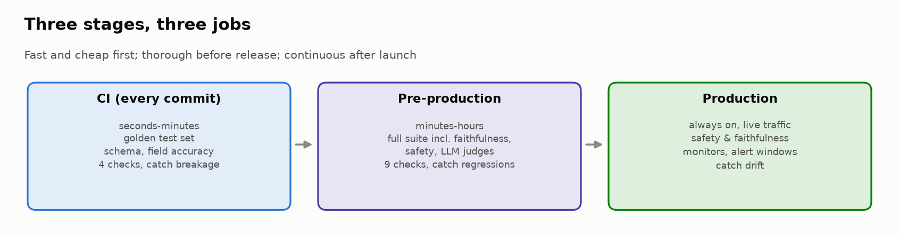
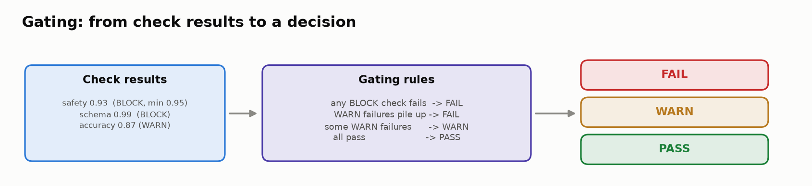
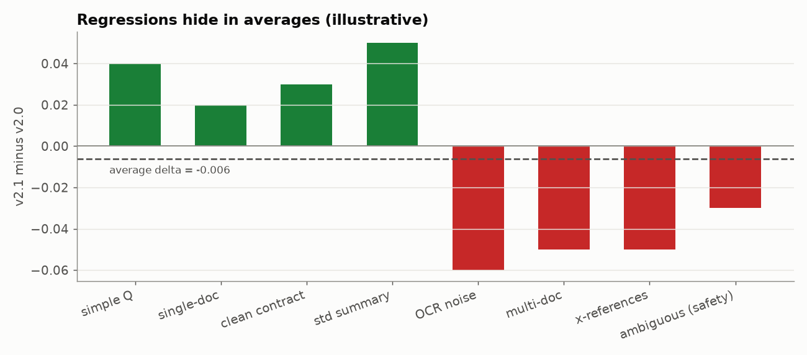

# 🏁 Module 08: End-to-End Evaluation Pipeline (Capstone)

> **Lab:** [`labs/08-end-to-end-pipeline-lab.ipynb`](../../labs/08-end-to-end-pipeline-lab.ipynb) · **Time:** 20–25 min · **Tools:** `pandas`, `numpy` · **Keys needed:** none



---

## 🧭 Overview

You now have evaluators for structured outputs, RAG, generated text, agents, robustness and safety. The capstone answers the question every team eventually faces: **how do all of these become one repeatable process that decides whether a new version ships?**

You're the **ML Evaluation Lead** for **LegalBot**, a legal-tech assistant with three components:

| Component | Job | Metrics in the dataset |
|---|---|---|
| 📋 **Structured** | Extract parties, dates, amounts, clauses from contracts | `field_accuracy`, `schema_compliance` |
| 📚 **RAG** | Answer questions over a legal knowledge base | `retrieval_recall`, `faithfulness`, `answer_correctness` |
| ✍️ **Generation** | Write executive summaries of contract reviews | `coherence`, `completeness`, `safety`, `tone` |

Version **v2.1** is ready to replace **v2.0**. Across **30 test cases** and **9 metrics**, 22 improved and **8 regressed**. Your job is to build the pipeline, run it, and make an evidence-based **go / no-go** call.

---

## 💡 Why This Matters

> 💡 The goal of an evaluation pipeline is not perfection; it's **informed confidence** in launch decisions.

Without a pipeline, every release is a debate about whose anecdote matters most. With one, you get:

- ⚡ **Fast feedback** on every commit (catch breakage in minutes, not in production).
- 🔍 **Thorough vetting** before release (catch regressions the fast checks can't see).
- 📡 **Continuous monitoring** after launch (catch drift no test set anticipated).
- 🧾 **An audit trail**: when leadership asks "what did we check before shipping v2.1?", you point to a config and a report.

In a legal product, one bad release can cause real harm to real people. The pipeline is part of the product.

---

## 🎯 Learning Objectives

After this module you will be able to:

1. **Design** a multi-stage evaluation workflow (CI → pre-production → production) and assign each metric to the right stage(s).
2. **Define** gating logic that turns check results into PASS / WARN / FAIL decisions, distinguishing BLOCK checks from WARN checks.
3. **Build** a readiness scorecard that communicates status, risks and a recommendation to non-technical stakeholders.
4. **Detect** regressions per test case and grade their severity, including regressions hidden by improving averages.
5. **Resolve** conflicting metrics with an explicit decision framework.
6. **Present** a launch decision backed by specific evidence.

---

## 📋 Prerequisites

- ✅ Modules 01–07 (you'll recognize every metric in the dataset).
- 🐼 `pandas` groupby/aggregation; basic statistics (means, deltas).

---

## 🧩 Key Concepts

### 1. 🏗️ Three stages, three jobs

| Stage | Runs | Budget | Typical checks | Catches |
|---|---|---|---|---|
| ⚡ **CI / pre-commit** | Every commit | Seconds–minutes | Golden set: schema compliance, field accuracy, key safety cases (lab: **4 checks**) | Breakage |
| 🔍 **Pre-production** | Each release candidate | Minutes–hours | Full suite incl. faithfulness, LLM judges, safety, robustness (lab: **9 checks**) | Regressions |
| 📡 **Production** | Continuously | Always on | Monitors on live traffic: safety, faithfulness, schema, with alert windows (lab: **4 monitors**) | Drift |

Think **funnel**: cheap, fast checks reject bad builds early; expensive checks only run on promising candidates. Notice in the lab config that **thresholds differ by stage**: lenient where you need speed, strict before release, and tuned for alerting in production.

### 2. 🚦 Gating: from numbers to decisions



Every check has a **threshold** and a **severity**:

- **BLOCK** checks are hard lines (e.g. safety, schema compliance). **One failure fails the stage.**
- **WARN** checks need judgment: one may be acceptable; several together can signal a systemic problem and should escalate to FAIL.

You implement this in `define_gating_criteria()` (Task 5). A good gate returns both a **status** and **reasons**: a FAIL without reasons is just another argument waiting to happen.

### 3. 📋 The readiness scorecard

A scorecard gives a decision-maker everything they need in **30 seconds**:

1. 🟢🟡🔴 **Overall status** (Ready / Conditional / Not Ready)
2. 🧩 **Component summary** (per component, v2.0 → v2.1)
3. 📉 **Regression summary** (what got worse, and how badly)
4. ⚠️ **Risks** if we deploy
5. ✅ **Recommendation** (go / no-go / conditional-go with specific mitigations)

Details stay available for those who dig in; the top line must be instantly clear. Scorecards are **versioned** and get referenced in launch reviews and post-mortems.

### 4. 🔎 Regression detection: look below the averages



Averages can improve while specific, important cases get worse. Compare **every test case** across versions and grade each drop:

| Severity (lab) | Rule | Verified count |
|---|---|---|
| 🚨 CRITICAL | drop > 5 percentage points | **2**: R-003 retrieval recall on expired contracts (0.80 → 0.75); G-006 completeness on cross-references (0.77 → 0.72) |
| ⚠️ MODERATE | smaller but meaningful | 4 |
| · MINOR | near the noise threshold (0.03) | 2 |

Plus **safety regressions**, which demand investigation at any size in a legal product: G-009 (ambiguous legal questions, 0.88 → 0.85) and G-007 (unauthorized legal interpretations, 0.95 → 0.93).

The metric summary shows the trap: e.g. **generation/completeness** has a *positive* average delta (+0.003) and still contains a critical regression. Rows with **avg_delta > 0 but regressions > 0** are exactly where "looks good on average" hides problems.

> 🔍 **Look for the pattern, not just the list.** v2.1 improves on simple, clean, single-document cases and regresses on **OCR noise, multi-document synthesis, cross-references and ambiguous inputs**: the hard tail. That pattern tells you *what changed* (a new retriever, chunking, or prompt template optimized for the common case).

### 5. ⚖️ Conflicting metrics need a framework

Metrics rarely all move together. In the lab:

- RAG faithfulness **single-document** 0.92 → **0.94** ✅, **multi-document synthesis** 0.84 → **0.79** ❌
- Generation coherence improves broadly ✅; completeness on cross-references ❌; safety on ambiguous questions ❌

These aren't independent events; they're **one change with different effects** on easy and hard cases. A decision framework turns judgment into something auditable. Example rules:

1. **Safety and compliance regressions block**, regardless of other gains.
2. Weigh regressions by **severity × scope** (how bad × how much traffic it affects).
3. A regression on a **high-stakes segment** outweighs improvements on low-stakes ones.
4. Improvements must be **outside noise** (Stretch: bootstrap confidence intervals) before they count.
5. A **conditional go** needs concrete mitigations: a guardrail, a routing rule (send multi-document questions to v2.0), or a tighter production monitor, with an owner and a rollback trigger.

### 6. 🎤 The decision is the deliverable

An evaluation that produces great data but no clear recommendation has failed its purpose. The executive summary should:

- state a **clear decision** (not "it depends"),
- cite **specific evidence** (test IDs, metrics, deltas),
- acknowledge **risks honestly**,
- propose **actionable next steps**,
- be readable by **non-technical** stakeholders.

### 7. 🔁 How the whole course fits together

| Stage | What runs there (and which module taught it) |
|---|---|
| CI | Schema + field checks (03), rule-based trace checks (01), regression suite of solved agent tasks (06b) |
| Pre-prod | Retrieval metrics + faithfulness (04/04b), claim/numeric/completeness + calibrated judges (05), agent end-state + gates + pass^k (06/06b), perturbations, safety layers, injection ASR (07/07b) |
| Production | Traced requests with scores on every step (01), failure clustering of incidents (02), the evaluation flywheel back into datasets (06) |

---

## 🧪 Example Walkthrough

```python
# 1) Stage config (Task 4): which checks run where, with which threshold and severity
evaluation_stages          # {"ci": {...4 checks...}, "pre_production": {...9...}, "production": {...4...}}

# 2) Gate (Task 5): you write define_gating_criteria(check_results) → {"status": ..., "reasons": [...]}
#    e.g. any BLOCK check below threshold → FAIL; several WARN failures → FAIL; some → WARN

# 3) Pipeline (Task 6): run_evaluation_pipeline(eval_df, evaluation_stages)
#    runs CI, then pre-production, applying your gate to each stage

# 4) Regressions (Task 8)
regressions = detect_regressions(eval_df, significance_threshold=0.03)
# → 8 regressions: 2 CRITICAL (R-003, G-006), 4 MODERATE, 2 MINOR; 2 touch safety
```

A defensible recommendation from these facts might be: **NO-GO for full rollout; conditional GO for single-document Q&A and clean contracts**, with multi-document and cross-reference requests routed to v2.0, a production safety monitor on ambiguous legal questions, and re-evaluation after fixing synthesis. (Yours may differ: what matters is that the evidence supports it.)

---

## ⚠️ Common Mistakes or Misunderstandings

| ❌ Mistake | ✅ Instead |
|---|---|
| One overall "model score" | Evaluate components and metrics separately. |
| Running every check on every commit | Fast checks in CI; full suite pre-production. |
| Treating all failed checks the same | BLOCK vs WARN, with explicit escalation rules. |
| Looking only at average deltas | Inspect every test case; grade regressions by severity. |
| Treating small safety drops as noise | In high-stakes domains, any safety regression gets investigated. |
| "Some things got better, some worse" | Find the **pattern** and what it says about the change. |
| Resolving conflicts by gut feel | Write a framework; apply it consistently. |
| A scorecard full of numbers and no recommendation | Status, risks and a recommendation up top. |
| "Monitor it" as a mitigation | Name the monitor, threshold, owner and rollback trigger. |

---

## 🚀 Before You Start the Lab

- 🧠 Task 3 asks which metrics belong in CI. Think about **speed** (LLM-judge metrics are slow and costly) and **criticality** (what must never break).
- ✍️ Tasks 5, 7, 9, 10 and 11 are yours to write. "TODO" outputs mean the function isn't implemented yet.
- 🎤 Draft your executive summary for someone who has 30 seconds and no ML background.

---

## 🔑 Key Takeaways

1. 🏗️ **Evaluation is multi-stage:** CI catches breakage, pre-prod catches regressions, production catches drift.
2. 🚦 **Gates turn metrics into decisions**, with BLOCK lines that a single failure crosses.
3. 📋 **Scorecards bridge engineering and leadership**: status, risks, recommendation.
4. 🔍 **Regressions hide in averages.** Inspect test cases and look for the pattern.
5. ⚖️ **Conflicting metrics need written frameworks**, not intuition.
6. 🏭 **The evaluation pipeline is part of the product**, and the decision is its deliverable.

---

## 🧠 Self-Check

<details>
<summary>1. Why not run the LLM-judge faithfulness check in CI?</summary>

It's slow and costs money per call, and CI runs on every commit. Keep CI fast and deterministic; run judge-based checks before release and sample them in production.
</details>

<details>
<summary>2. A metric's average delta is +0.003 but it contains a critical regression. What does that tell you?</summary>

Improvements elsewhere are masking a severe drop on specific cases. Averages hide regressions; inspect per-case deltas.
</details>

<details>
<summary>3. Single-document faithfulness improves and multi-document faithfulness regresses. Two events or one?</summary>

Most likely one architectural change (retrieval, chunking or prompt) that helps easy cases and hurts complex synthesis.
</details>

<details>
<summary>4. Give an example of a concrete conditional-go mitigation.</summary>

Route multi-document questions to v2.0, add a production alert on safety for ambiguous legal questions (threshold, owner, rollback trigger), and re-evaluate after a synthesis fix.
</details>

---

## 📖 Glossary

**CI** · continuous integration: checks on every commit. **Pre-production** · thorough evaluation of a release candidate. **Production monitoring** · continuous checks on live traffic. **Gate** · rule mapping results to PASS/WARN/FAIL. **BLOCK / WARN check** · hard line / judgment call. **Readiness scorecard** · stakeholder summary of status, risks and recommendation. **Regression** · a test case that got worse. **Drift** · production behavior changing over time. **Conditional go** · ship with specific mitigations and triggers.
